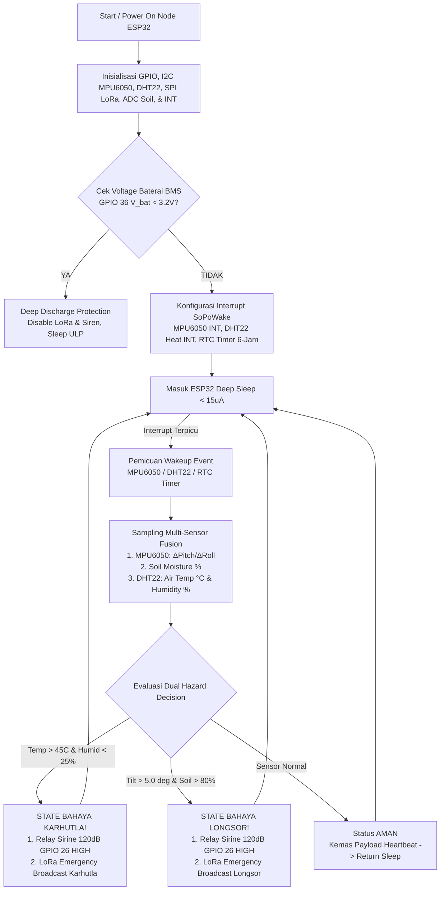
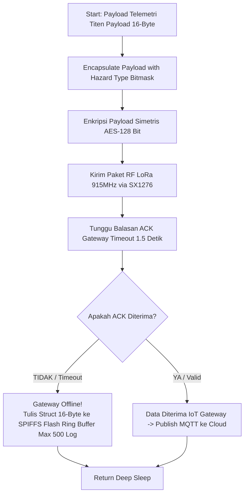
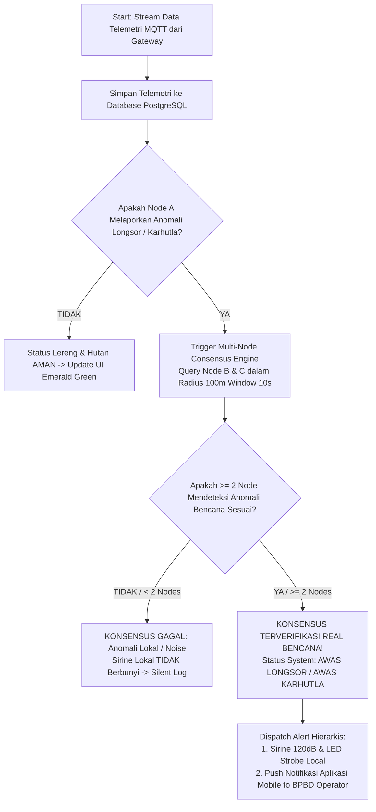
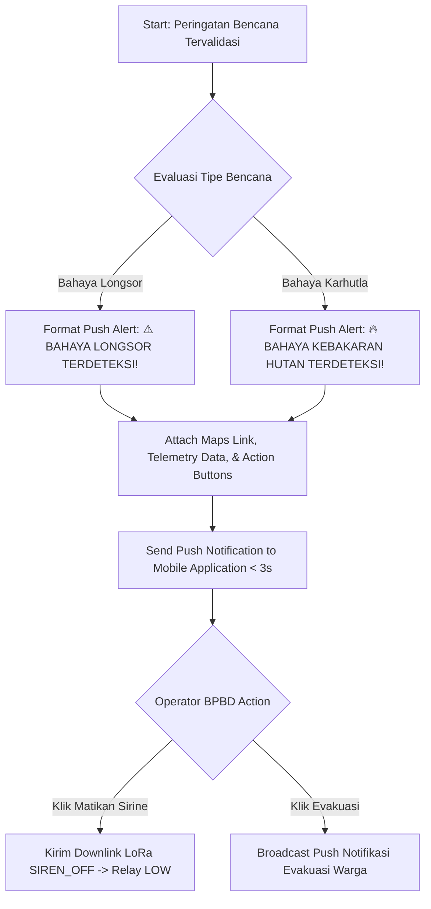

# Dokumentasi Flowchart & Activity Diagram System - TITEN EWS

> **Versi Dokumen**: v2.1.0  
> **Target Sistem**: TITEN IoT Early Warning System (Landslide & Forest Fire Dual Detection, SoPoWake Deep Sleep, LoRa 915MHz, Multi-Node Consensus, Flutter Light Mobile UX & FCM Push Notifications)  
> **Format File XML Draw.io**: Tersedia di direktori `c:\laragon\www\Titen\Flow\xml\`

---

## Ringkasan Direktori File Draw.io XML

Semua diagram dalam dokumen ini telah dibuat dalam format **Draw.io XML (`.drawio`)** siap pakai yang dapat langsung di-import atau dibuka melalui [Draw.io / Diagrams.net](https://app.diagrams.net).

| No | Nama Kategori | File Flowchart & Activity Diagram XML |
| :--- | :--- | :--- |
| **01** | **Edge Dual Sensing & SoPoWake Power Management** | [01_edge_sensing_sopowake.drawio.xml](file:///c:/laragon/www/Titen/Flow/xml/01_edge_sensing_sopowake.drawio.xml) |
| **02** | **Transmisi LoRa & Offline Data Buffering** | [02_lora_transmission_buffering.drawio.xml](file:///c:/laragon/www/Titen/Flow/xml/02_lora_transmission_buffering.drawio.xml) |
| **03** | **Cloud Backend & Dual Hazard Multi-Node Consensus Engine** | [03_cloud_consensus_engine.drawio.xml](file:///c:/laragon/www/Titen/Flow/xml/03_cloud_consensus_engine.drawio.xml) |
| **04** | **Peringatan Hierarkis, Sirine Lokal & Push Notifikasi Mobile** | [04_hierarchical_alert_mobile_siren.drawio.xml](file:///c:/laragon/www/Titen/Flow/xml/04_hierarchical_alert_mobile_siren.drawio.xml) |
| **05** | **Antarmuka Mobile Light Mode Flutter UX & Interaksi** | [05_gotham_friendly_ui_interaction.drawio.xml](file:///c:/laragon/www/Titen/Flow/xml/05_gotham_friendly_ui_interaction.drawio.xml) |

---

## Kategori 1: Edge Dual Sensing (Longsor & Karhutla) & SoPoWake

### 1.1 Deskripsi Alur & Logika Keputusan Dual Bencana
ESP32 menggunakan mode *Deep Sleep* (< 15µA) dan terbangun oleh 3 pemicu hardware:
1. **Interrupt Motion MPU6050 (GPIO 33)**: Akselerasi $> 0.15\,\text{g}$ atau perubahan sudut $\Delta\theta > 2.0^\circ$.
2. **Interrupt Heat/DHT22 (GPIO 27)**: Lonjakan suhu udara $> 45.0^\circ\text{C}$ atau kelembapan udara drop $< 25\%$.
3. **Timer RTC Internal**: Laporan rutin heartbeat setiap 6 jam sekali.

Saat terbangun, ESP32 membaca MPU6050 (Kemiringan), Capacitive Soil Probe (Kelembapan Tanah), dan DHT22 (Suhu & Kelembapan Udara), lalu mengevaluasi *Dual Hazard Decision*:
- **Cabang Longsor**: JIKA $\Delta\theta > 5.0^\circ$ DAN Kelembapan Tanah $> 80\% \longrightarrow$ `BAHAYA LONGSOR`.
- **Cabang Karhutla**: JIKA Suhu Udara $> 45.0^\circ\text{C}$ DAN Kelembapan Udara $< 25\% \longrightarrow$ `BAHAYA KARHUTLA`.
- **Normal**: JIKA semua sensor di bawah threshold $\longrightarrow$ Status `AMAN`.

### 1.2 Flowchart Edge Dual Sensing & SoPoWake


---

## Kategori 2: Transmisi LoRa Dual Bencana & Offline Buffering



---

## Kategori 3: Cloud Backend & Dual Hazard Multi-Node Consensus Engine



---

## Kategori 4: Peringatan Hierarkis & Remote Override via Push Notifikasi Mobile



---

## Kategori 5: Antarmuka Mobile Light Mode Flutter UX

```mermaid
flowchart TD
    A[Start: User membuka Aplikasi Mobile] --> B[Render Light Mode Palette #F8FAFC & #FFFFFF]
    B --> C[Render Mobile Viewport Frame & Top Bar]
    C --> D[Active Bottom Navigation Bar: Status | Peta | Logs | Alerts]
    D --> E[Simulasi Dual Hazard Bar: Aman | Waspada Longsor | Waspada Karhutla | Siaga | AWAS Longsor | AWAS Karhutla]
    E --> F[Update Dynamic Hero Banner & Bento Telemetry Cards]
```
