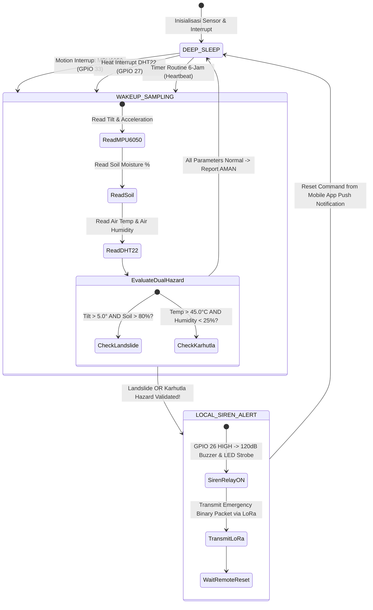

# Product Requirement Document (PRD)
## TITEN: Sistem Peringatan Dini Tanah Longsor & Kebakaran Hutan
**Solusi Mitigasi Bencana Ganda Berbasis IoT Edge Computing, LoRa 915MHz, & Gotham-Light Mobile UX**

---

### Informasi Dokumen

| Parameter | Detail |
| :--- | :--- |
| **Nama Produk** | TITEN (Sistem Peringatan Dini Tanah Longsor & Kebakaran Hutan) |
| **Kompetisi Target**| MAGE 12 (Multimedia and Game Event 12) - Subtema: *Climate Disaster Technology* |
| **Versi Dokumen** | v2.1.0 (Mobile App Push Notification Spec) |
| **Tim Penyusun** | TRILOGY (Muhammad Zahir Siraj, Zabdan Harjati Purnomo, Muhammad Rasya Al Faridzi) |
| **Institusi** | SMK Budi Luhur, Kota Tangerang |
| **Tahun Target** | 2026 |
| **Status Dokumen** | Approved for Full Implementation |

---

## 1. Executive Summary & Visi Produk

### 1.1 Ringkasan Eksekutif
**TITEN** adalah sistem mitigasi bencana ganda berbasis *Internet of Things* (IoT) dan *Edge Computing* yang dirancang khusus untuk memantau dua ancaman bencana alam utama di kawasan pedalaman Indonesia: **Tanah Longsor** pada lereng/tebing curam dan **Kebakaran Hutan/Lahan (Karhutla)** di area vegetasi rawan.

Sistem ini menggabungkan arsitektur daya mandiri **SoPoWake** (*Solar Powered Wake-on-Threshold*) dengan sensor fisik komplit:
1. **MPU6050 Accelerometer**: Memantau kemiringan tanah (*tilt degree*) dan getaran mekanis lereng.
2. **Capacitive Soil Moisture Sensor**: Memantau kejenuhan air di dalam struktur tanah.
3. **DHT22 Sensor**: Memantau suhu udara dan kelembapan udara lingkungan untuk mendeteksi gelombang panas dan indikasi awal kebakaran hutan.

Mikrokontroler ESP32 beroperasi dalam mode *deep sleep* ultra-hemat daya dan bangun secara otomatis setiap 6 jam sekali (heartbeat) atau seketika (*instant motion & heat interrupt*) saat sensor membaca pergerakan tanah atau lonjakan suhu udara ekstrem. Peringatan dini dieksekusi melalui 2 jalur: alarm lokal independen (Buzzer 120dB & LED Strip Strobe) dan penyiaran radio jarak jauh berbasis **LoRa 915MHz** menuju IoT Gateway di pemukiman warga, yang diteruskan via WiFi ke aplikasi mobile Flutter dan Push Notification Service (FCM).

```
       +-------------------------------------------------------------------+
       |                     TITEN ARCHITECTURE OVERVIEW                   |
       +-------------------------------------------------------------------+
       |                                                                   |
   [ EDGE SENSOR NODE ]  --(LoRa 915MHz)-->  [ LoRa GATEWAY NODE ]           |
   - ESP32 + SX1276                           - ESP32 + SX1276 + WiFi      |
   - MPU6050 (Tilt & Getaran)                 - LoRa Receiver -> WiFi Gateway|
   - Capacitive Soil Moisture                               |              |
   - DHT22 (Suhu & Kelembapan Udara)                      (MQTT)           |
   - SoPoWake Solar 10WP + Baterai                          v              |
   - Siren Relay 120dB + LED Strip Strobe    [ CLOUD & CONSENSUS SERVER ]    |
                                              - Multi-Node Consensus Engine|
                                              - Database & FCM Push Service|
                                                             |              |
                                             +---------------+---------------+
                                             |                               |
                                             v                               v
                                [ FLUTTER LIGHT MOBILE APP ]    [ MOBILE PUSH SERVICE (FCM) ]
                                - Responsive Mobile Viewport    - Instant High-Priority Alert
                                - Dual Hazard Cards             - Downlink Siren Remote
                                - Spatial Topography Map        - Evacuation Protocol
                                                                            |
       +-------------------------------------------------------------------+
```

### 1.2 Visi & Nilai Utama (Core Value Proposition)
1. **Perlindungan Bencana Ganda (Dual Hazard Protection)**: Satu perangkat terpadu mampu mendeteksi potensi pergeseran tebing (longsor) sekaligus titik panas & cuaca ekstrem pemicu karhutla.
2. **Kemandirian Energi Total (Zero Power Dependency)**: Pengisian daya otomatis via panel surya & baterai Li-ion 18650 dipadu mode *deep sleep* ESP32 (< 15µA), mampu siaga 24 jam penuh di lokasi terpencil tanpa jaringan listrik PLN.
3. **Peringatan Lokal Tanpa Internet (Zero Latency Local Alert)**: Buzzer 120dB dan LED strip darurat aktif langsung di lokasi dalam waktu < 500ms saat bahaya terdeteksi tanpa bergantung pada koneksi internet.
4. **Komunikasi LoRa Jarak Jauh (Long-Range Mesh Telemetry)**: Menembus rintangan hutan dan perbukitan tanpa butuh sinyal seluler hingga radius 2km (NLOS) / 10km (LOS).
5. **Verifikasi Silang Bebas Alarm Palsu (Multi-Node Consensus)**: Mengeliminasi alarm palsu akibat gangguan hewan atau cuaca sesaat dengan memvalidasi sinyal di 3 node sensor berdekatan.

---

## 2. User Personas & User Stories

### 2.1 User Personas

```
+-----------------------------------------------------------------------------------+
| PERSONA 1: Pak Bambang (52 Th) - Warga & Perangkat Desa (RT/RW)                   |
+-----------------------------------------------------------------------------------+
| - Latar Belakang: Tinggal di dekat tebing curam dan pinggiran hutan.              |
| - Kebutuhan: Peringatan suara/visual tajam di lokasi & tampilan aplikasi HP yang   |
|   sangat jelas ("Aman", "Bahaya Longsor", atau "Bahaya Karhutla").                 |
| - Pain Point: Peringatan palsu yang membingungkan atau alat mati karena baterai habis.|
+-----------------------------------------------------------------------------------+

+-----------------------------------------------------------------------------------+
| PERSONA 2: Mbak Rina (29 Th) - Operator BPBD / Tim SAR                            |
+-----------------------------------------------------------------------------------+
| - Latar Belakang: Mengelola sistem komando mitigasi bencana kabupaten.            |
| - Kebutuhan: Data detail pergerakan sudut lereng, kejenuhan tanah, suhu udara,    |
|   kelembapan udara, peta lokasi presisi, push notifikasi aplikasi mobile, & log.  |
| - Pain Point: Informasi ambigu mengenai tipe bencana (longsor vs kebakaran).      |
+-----------------------------------------------------------------------------------+

+-----------------------------------------------------------------------------------+
| PERSONA 3: Mas Farhan (25 Th) - Teknisi Lapangan IoT                              |
+-----------------------------------------------------------------------------------+
| - Latar Belakang: Bertanggung jawab atas kesehatan perangkat keras di lapangan.   |
| - Kebutuhan: Telemetri sisa baterai (BMS), kualitas sinyal LoRa (RSSI/SNR), &     |
|   status fungsi tiap sensor (MPU6050, Soil Probe, DHT22).                        |
| - Pain Point: Kesulitan mendiagnosis kerusakan fisik di lokasi hutan/tebing.      |
+-----------------------------------------------------------------------------------+
```

### 2.2 User Stories

| ID | Persona | As a... | I want to... | So that... |
| :--- | :--- | :--- | :--- | :--- |
| **US-01** | Warga | Warga sekitar lokasi | Mendengar sirine 120dB & melihat LED darurat di lokasi saat longsor/karhutla | Saya dan keluarga dapat segera mengevakuasi diri sebelum bencana membesar. |
| **US-02** | BPBD | Operator BPBD | Menerima push notifikasi aplikasi mobile instan lengkap dengan jenis bencana (Longsor/Karhutla) & koordinat | Tim Reaksi Cepat / Pemadam dapat dikirim tepat target tanpa penundaan. |
| **US-03** | BPBD | Operator BPBD | Memvalidasi apakah bahaya dikonfirmasi oleh minimal 2 dari 3 node sensor | Petugas tidak membuang sumber daya akibat alarm palsu karena hewan/pohon tumbang. |
| **US-04** | Perangkat Desa| Head of Village | Memantau grafik suhu, kelembapan, & kemiringan di aplikasi mobile light mode | Saya dapat mengambil keputusan siaga bencana secara cepat dalam rapat desa. |
| **US-05** | Teknisi | Teknisi Lapangan | Menguji fungsi sirine lokal via aplikasi mobile dengan keamanan PIN 4-digit | Pengujian berkala dapat dilakukan tanpa memicu kepanikan massal warga. |

---

## 3. Scope & Constraints System

### 3.1 Scope Produk (In-Scope vs Out-of-Scope)

#### In-Scope:
* Deteksi kemiringan tanah & getaran mekanis tebing via MPU6050 Accelerometer.
* Deteksi kejenuhan air dalam tanah via Capacitive Soil Moisture Sensor.
* Deteksi suhu udara & kelembapan udara lingkungan via DHT22 Sensor.
* Algoritma *Dual Hazard Validation* di Edge ESP32 (Longsor vs Karhutla).
* Manajemen daya SoPoWake (Panel Surya 10WP + Baterai 18650 6000mAh + Deep Sleep).
* Komunikasi nirkabel LoRa 915MHz antara Sensor Node dan IoT Gateway.
* Sistem peringatan lokal: Relay Buzzer 120dB + LED Strip Strobe.
* Multi-Node Consensus Engine (3 Node Verification).
* Aplikasi Mobile Light Mode Flutter Aesthetic (`index.html`, `index.css`, `app.js`).
* Push Notification Service ke Aplikasi Mobile Flutter (FCM).

#### Out-of-Scope:
* Pemadaman otomatis kebakaran hutan berbasis sprinkler air.
* Pengukuran komposisi kimiawi gas emisi tanah (CO2/CO2 sensor industri khusus).
* Citra satelit radar SAR real-time.

---

## 4. Requirement Fungsional (FR)

### FR-1: Multi-Sensor Fusion & Dual Hazard Sensing
* **FR-1.1**: ESP32 wajib membaca kemiringan tanah ($\Delta\theta$) & percepatan inersia dari MPU6050 via jalur I2C (SDA GPIO 21, SCL GPIO 22).
* **FR-1.2**: ESP32 wajib membaca kelembapan tanah (%) dari Capacitive Soil Sensor via jalur Analog ADC (GPIO 34).
* **FR-1.3**: ESP32 wajib membaca suhu udara ($^\circ\text{C}$) & kelembapan udara (%) dari DHT22 via jalur Digital (GPIO 27 / GPIO 4).
* **FR-1.4**: Sistem wajib mengevaluasi parameter fisik menjadi dua cabang bencana:
  - **Kondisi Longsor**: Kemiringan $\Delta\theta > 5.0^\circ$ DAN Kelembapan Tanah $> 80\%$.
  - **Kondisi Karhutla**: Suhu Udara $> 45.0^\circ\text{C}$ DAN Kelembapan Udara $< 25\%$.

### FR-2: Manajemen Daya Adaptif SoPoWake
* **FR-2.1**: Dalam kondisi normal, ESP32 masuk ke mode `Deep Sleep` dengan konsumsi arus $< 15\,\mu\text{A}$.
* **FR-2.2**: Sensor MPU6050 & DHT22 wajib mendukung *Hardware Interrupt* (INT GPIO 33) saat mendeteksi getaran tiba-tiba atau kenaikan suhu tajam (*Wake-on-Threshold*).
* **FR-2.3**: Timer internal (*RTC Timer*) wajib membangunkan sistem setiap 6 jam sekali untuk laporan status rutin ("AMAN").

### FR-3: Komunikasi LoRa & Offline Data Buffering
* **FR-3.1**: Node sensor mengemas data telemetri dalam format biner padat 16-Byte `FirmusPayload` dan mengirimkannya via LoRa 915MHz ke Gateway.
* **FR-3.2**: Jika gateway offline, data disimpan di memori internal SPIFFS Flash (hingga 500 log) dan disinkronkan otomatis saat terhubung kembali.

### FR-4: Multi-Node Consensus Engine
* **FR-4.1**: Engine cloud memverifikasi sinyal bahaya dari Node 01 dengan Node 02 dan Node 03 dalam radius 100m.
* **FR-4.2**: Status alarm **AWAS** (Longsor / Karhutla) hanya diaktifkan penuh jika minimal 2 dari 3 node menyetujui anomali bencana yang sama.

---

## 5. Requirement Non-Fungsional (NFR)

* **NFR-1 (Latensi Signal Lokal)**: Waktu pemicuan MPU6050/DHT22 hingga buzzer 120dB berbunyi $< 500\,\text{ms}$.
* **NFR-2 (Daya Tahan Operasional)**: Baterai 18650 6000mAh + Panel surya mampu menopang perangkat beroperasi continuous minimum 120 hari dalam kondisi mendung/tanpa matahari.
* **NFR-3 (Ketahanan Fisik Enclosure)**: Box pelindung memenuhi standar waterproof IP66 tahan hujan deras, debu, dan suhu ekstrem $-10^\circ\text{C}$ hingga $+65^\circ\text{C}$.

---

## 6. Detail Pinout & Hardware Architecture

### Skema Pinout ESP32 Node Sensor:

| Komponen Hardware | Interface / Protokol | Pin ESP32 | Keterangan Fungsi |
| :--- | :--- | :--- | :--- |
| **MPU6050 (Gyro/Acc)** | I2C (SDA / SCL) | GPIO 21 / GPIO 22 | Deteksi kemiringan & getaran tebing |
| | Digital Interrupt | GPIO 33 | Wake-on-Threshold pergerakan tanah |
| **Capacitive Soil Probe** | Analog ADC1 | GPIO 34 | Membaca kejenuhan air tanah |
| **DHT22 Temp & Humidity** | Digital Data | GPIO 27 | Membaca suhu & kelembapan udara karhutla |
| **LoRa SX1276 Module** | SPI (SCK/MISO/MOSI)| GPIO 18 / 19 / 23 | Transmisi radio nirkabel 915MHz |
| | CS / RST / DIO0 | GPIO 5 / 14 / 2 | Kontrol & Interrupt Packet LoRa |
| **Relay Sirine & LED** | Digital Output | GPIO 26 | Mengaktifkan Buzzer 120dB & LED Strobe |
| **BMS Battery Monitor** | Analog ADC (Divider)| GPIO 36 (VP) | Membaca tegangan baterai 3.7V Li-ion |

---

## 7. Struct Telemetri LoRa (Packed Binary 16 Bytes)

```c
typedef struct __attribute__((__packed__)) {
    uint8_t  node_id;         // 1 Byte: ID Node Sensor (1-255)
    uint8_t  battery_pct;     // 1 Byte: Sisa Baterai (0-100%)
    int16_t  tilt_x10;        // 2 Byte: Sudut Kemiringan x 10 (misal: 14.5 deg -> 145)
    uint8_t  soil_moisture;   // 1 Byte: Kelembapan Tanah (0-100%)
    int16_t  air_temp_x10;    // 2 Byte: Suhu Udara DHT22 x 10 (misal: 48.2 C -> 482)
    uint8_t  air_humidity;    // 1 Byte: Kelembapan Udara DHT22 (0-100%)
    uint8_t  hazard_type;     // 1 Byte: 0: Normal, 1: Longsor, 2: Karhutla
    uint8_t  status_level;    // 1 Byte: 0: Aman, 1: Waspada, 2: Siaga, 3: Awas
    uint32_t timestamp_rtc;   // 4 Byte: Unix Timestamp RTC Perangkat
    uint16_t checksum;        // 2 Byte: CRC16 Checksum Data
} TitenPayload;               // Total: 16 Bytes
```

---

## 8. Logika Algoritma Edge (State Machine Dual Hazard)



---

## 9. Antarmuka Mobile Light Mode (Flutter Aesthetic)

Aplikasi mobile dirancang menggunakan skema **Firmus Tactical Light**:
- **Palette**: Surface White (`#FFFFFF`), Base Background (`#F8FAFC`), Outline Border (`#E2E8F0`), Main Text (`#0F172A`).
- **Status Colors**:
  - Aman: Emerald `#10B981`
  - Waspada: Amber `#F59E0B`
  - Siaga: Orange `#F97316`
  - Awas Longsor: Crimson `#EF4444`
  - Awas Karhutla: Flame Orange `#EA580C`
- **Features**: Responsive Mobile Container Viewport, Flutter Bottom Navigation Bar (Status, Peta, Logs, Alerts), Dual Hazard Telemetry Bento Grid, Spatial GIS Canvas Map, and Security PIN Modal.
