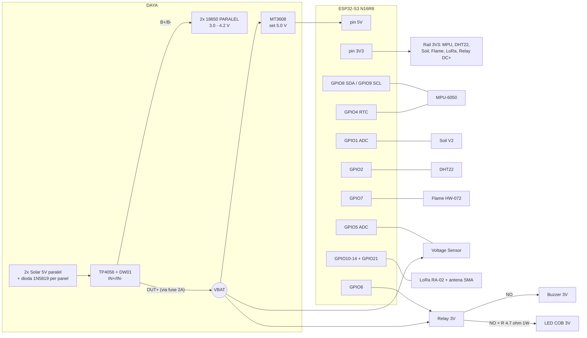

# PINOUT V2 — TITEN (Node Sensor + Gateway)

> **Status**: Usulan final v2 · 6 Okt 2026 · menggantikan [`pinout.md`](../pinout.md) setelah direview tim
> **Basis**: komponen fisik di folder [`Komponen/`](../Komponen), firmware di [`firmware/`](../firmware), proposal Tahap 1, BOM pengajuan biaya.

---

## 0. Ringkasan 10 Detik

| | Node Sensor (lereng) | Gateway (posko) |
| :--- | :--- | :--- |
| **Board** | ESP32-S3-DevKitC-1 **N16R8** + GPIO Extension Board | **ESP32 DevKit V1 30-pin (WROOM-32)** + Expansion Board G-V-S ✅ sudah ada |
| **Radio** | LoRa RA-02 SX1278 **433 MHz** | LoRa RA-02 SX1278 **433 MHz** |
| **Bus I2C** | SDA **8** · SCL **9** → MPU-6050 (`0x68`) | SDA **21** · SCL **22** → LCD 16x2 (`0x27`/`0x3F`) |
| **Bus SPI LoRa** | SCK **12** · MISO **13** · MOSI **11** · NSS **10** · RST **14** · DIO0 **21** | SCK **18** · MISO **19** · MOSI **23** · NSS **5** · RST **14** · DIO0 **26** |
| **Daya** | 2×18650 → TP4056 → **MT3608 5V** → pin 5V | Adaptor 5V via USB-C expansion **atau** 9V via DC jack |

**Perubahan dari pinout lama:** cuma **Flame DO: GPIO 3 ➜ GPIO 7**. Ditambah GPIO 15 sebagai `SENSOR_EN` opsional. Detail ada di §8.

---

## 1. Legenda

| Simbol | Arti |
| :---: | :--- |
| ◆ | Dipakai TITEN |
| ◇ | Cadangan / opsional (sudah dialokasikan) |
| ○ | Bebas, aman dipakai nanti |
| ⚠ | Bisa dipakai tapi berisiko (strapping/JTAG) — hindari |
| ✗ | **DILARANG** — terhubung ke flash/PSRAM/USB/UART/LED internal |

---

## 2. Peta Header Fisik ESP32-S3 N16R8 (sesuai Extension Board di foto)

Posisi: **antena PCB di atas, 2 port USB-C di bawah**. Urutan baris sama persis dengan label di extension board.

| # | Header KIRI | Status | Fungsi TITEN | | Header KANAN | Status | Fungsi TITEN |
| :-: | :--- | :-: | :--- | :-: | :--- | :-: | :--- |
| 1 | 3V3 | ● | Rail 3.3V sensor | | GND | ● | Ground |
| 2 | 3V3 | ● | Rail 3.3V LoRa | | TX (43) | ✗ | UART0 (debug) |
| 3 | RST | ✗ | Tombol reset | | RX (44) | ✗ | UART0 (debug) |
| 4 | **IO4** | ◆ | **MPU-6050 INT** (wake) | | **IO1** | ◆ | **Soil AOUT** (ADC1_CH0) |
| 5 | **IO5** | ◆ | **Voltage Sensor S** (ADC1_CH4) | | **IO2** | ◆ | **DHT22 DATA** |
| 6 | **IO6** | ◆ | **Relay IN** (alarm) | | IO42 | ⚠ | JTAG MTMS |
| 7 | **IO7** | ◆ | **Flame DO** *(baru)* | | IO41 | ⚠ | JTAG MTDI |
| 8 | IO15 | ◇ | `SENSOR_EN` (opsional) | | IO40 | ⚠ | JTAG MTDO |
| 9 | IO16 | ○ | — | | IO39 | ⚠ | JTAG MTCK |
| 10 | IO17 | ○ | — | | IO38 | ✗ | LED RGB (DevKitC v1.1) |
| 11 | IO18 | ○ | — | | IO37 | ✗ | **Octal PSRAM** |
| 12 | **IO8** | ◆ | **I2C SDA** | | IO36 | ✗ | **Octal PSRAM** |
| 13 | IO3 | ⚠ | Strapping (JTAG sel) | | IO35 | ✗ | **Octal PSRAM** |
| 14 | IO46 | ✗ | Strapping (boot) | | IO0 | ✗ | Tombol BOOT |
| 15 | **IO9** | ◆ | **I2C SCL** | | IO45 | ✗ | Strapping (VDD_SPI) |
| 16 | **IO10** | ◆ | **LoRa NSS** | | IO48 | ✗ | LED RGB (DevKitC v1.0) |
| 17 | **IO11** | ◆ | **LoRa MOSI** | | IO47 | ○ | — |
| 18 | **IO12** | ◆ | **LoRa SCK** | | **IO21** | ◆ | **LoRa DIO0** |
| 19 | **IO13** | ◆ | **LoRa MISO** | | IO20 | ✗ | USB D+ (Serial Monitor) |
| 20 | **IO14** | ◆ | **LoRa RST** | | IO19 | ✗ | USB D− (Serial Monitor) |
| 21 | 5V | ● | **Input dari MT3608** | | GND | ● | Ground |
| 22 | GND | ● | Ground | | GND | ● | Ground |

> [!WARNING]
> **Pin terlarang di N16R8 (koreksi dari dokumen lama):**
> - **GPIO 26–32**: SPI Flash. Tidak keluar di header, jadi aman dengan sendirinya.
> - **GPIO 35, 36, 37**: Octal PSRAM. **Pin ini KELUAR di extension board kamu.** Kalau disambung, board akan boot-loop/crash.
> - **GPIO 19, 20**: USB native. Kalau dipakai, Serial Monitor (`USB CDC On Boot = Enabled`) mati.
> - **GPIO 43, 44**: UART0. **GPIO 0, 3, 45, 46**: strapping pin. **GPIO 38/48**: LED RGB onboard.

**Kenapa pin-pin ini yang dipilih:**
- Semua sinyal penting ada di **header kiri bagian atas** (IO4–IO7) dan **satu blok berurutan** IO8–IO14, jadi kabelnya pendek dan rapi.
- Soil & baterai ada di **ADC1** (GPIO 1–10). ADC2 bentrok dengan WiFi, jadi dihindari.
- MPU INT di **GPIO 4** karena harus RTC GPIO (0–21) supaya bisa dipakai untuk `ext0` wake-up dari deep sleep.
- LoRa memakai pin **FSPI default** S3 (10/11/12/13), jadi performa SPI-nya maksimal.

---

## 3. Tabel Pengkabelan Node Sensor (per terminal)

Konvensi warna kabel (disarankan supaya gampang di-debug):
🔴 Merah = 3V3 · 🟠 Oranye = 5V/VBAT · ⚫ Hitam = GND · 🟡 Kuning = sinyal analog/digital · 🟢 Hijau = I2C · 🔵 Biru = SPI

### 3.1 MPU-6050 (GY-521) — kemiringan & getaran

| Pin modul | → ESP32-S3 | Kabel | Catatan |
| :--- | :--- | :-: | :--- |
| VCC | 3V3 | 🔴 | GY-521 punya LDO onboard, jadi input 3.3V tetap jalan |
| GND | GND | ⚫ | |
| SCL | **GPIO 9** | 🟢 | Pull-up 4.7k sudah ada di modul |
| SDA | **GPIO 8** | 🟢 | |
| XDA / XCL | — | — | Biarkan kosong |
| AD0 | GND | ⚫ | Supaya alamat I2C tetap **0x68** |
| INT | **GPIO 4** | 🟡 | Active-HIGH, *latched*. Ini yang membangunkan ESP32 |

> [!IMPORTANT]
> MPU-6050 **harus menempel kaku** ke dasar box (pakai baut atau lem epoxy, jangan cuma di breadboard). Box juga harus terbaut kaku ke tiang. Sumbu X/Y sensor harus sejajar dengan arah lereng.

### 3.2 Capacitive Soil Moisture V2.0 (HW-390) — kejenuhan tanah

| Pin modul | → ESP32-S3 | Kabel | Catatan |
| :--- | :--- | :-: | :--- |
| VCC | 3V3 (atau GPIO 15 `SENSOR_EN`, lihat §5.3) | 🔴 | |
| GND | GND | ⚫ | |
| AOUT | **GPIO 1** (ADC1_CH0) | 🟡 | Kering ≈ 3100, basah ≈ 1300. **Wajib dikalibrasi ulang** |

> [!NOTE]
> Cek tulisan di IC 8-kaki pada probe. Kalau **TLC555**, 3.3V aman. Kalau **NE555**, butuh ≥ 4.5V, jadi ambil VCC dari 5V. Output AOUT tetap < 3V, tapi ukur dulu pakai multimeter. Probe masuk ke box lewat **cable gland PG7**. Panjang kabel maksimal ±1.5 m supaya sinyal analog tidak terlalu noisy.

### 3.3 DHT22 (modul 3-pin `+ out −`) — suhu & kelembapan udara

| Pin modul | → ESP32-S3 | Kabel | Catatan |
| :--- | :--- | :-: | :--- |
| `+` | 3V3 | 🔴 | |
| `out` | **GPIO 2** | 🟡 | Pull-up 10k sudah ada di modul |
| `−` | GND | ⚫ | |

> [!CAUTION]
> **Jangan taruh DHT22 di dalam box tertutup.** Box yang kena matahari bisa panas sampai 50–60 °C, jadi sistem akan **alarm Karhutla palsu**. Taruh DHT22 **di luar box**, di bawah bayangan panel surya, dengan pelindung hujan berventilasi (*radiation shield*).

### 3.4 Flame Sensor (HW-072, 3-pin — di BOM tertulis "KY-026")

| Pin modul | → ESP32-S3 | Kabel | Catatan |
| :--- | :--- | :-: | :--- |
| VCC | 3V3 | 🔴 | |
| GND | GND | ⚫ | |
| DO | **GPIO 7** *(dulu GPIO 3)* | 🟡 | **LOW = api terdeteksi**. Sensitivitas diatur lewat trimpot biru |

> [!WARNING]
> Sensor IR 760–1100 nm ini **juga bereaksi ke sinar matahari langsung**. Jangan pakai flame sensor sebagai satu-satunya pemicu AWAS. Jadikan bukti pendukung, dan tutup sensor dari matahari langsung.

### 3.5 Voltage Sensor 0–25V — monitor baterai

| Terminal modul | → Tujuan | Kabel | Catatan |
| :--- | :--- | :-: | :--- |
| Terminal **VCC** (sekrup) | **OUT+ TP4056** (= +baterai) | 🟠 | Yang diukur adalah tegangan baterai |
| Terminal **GND** (sekrup) | **OUT− TP4056** (= GND sistem) | ⚫ | **Bukan B−!** (lihat §5.1) |
| Header **S** | **GPIO 5** (ADC1_CH4) | 🟡 | Rasio 5:1, jadi 4.2V terbaca 0.84V |
| Header **−** | GND ESP32 | ⚫ | |
| Header **+** | **JANGAN DISAMBUNG** | — | Di modul ini pin `+` tidak terhubung (NC) |

Di firmware, pakai `analogReadMilliVolts(5) * 5` (sudah terkalibrasi eFuse). Jangan pakai `raw/4095*3.3` karena ADC S3 tidak linier.

### 3.6 Relay 1-Channel 3V (JQC3F-03VDC-C, ada optocoupler + jumper Low/High)

| Terminal modul | → Tujuan | Kabel | Catatan |
| :--- | :--- | :-: | :--- |
| DC+ | **3V3** | 🔴 | **Koil 3V, JANGAN dikasih 5V** (dokumen lama keliru) |
| DC− | GND | ⚫ | |
| IN | **GPIO 6** | 🟡 | Tambahkan **resistor 10k dari IN ke GND** supaya relay tetap OFF saat boot & deep sleep |
| Jumper | **High** | — | Sesuai firmware: `HIGH = alarm ON` |
| COM | **OUT+ TP4056** (VBAT, lewat fuse) | 🟠 | Beban alarm ambil daya langsung dari baterai |
| NO | → Buzzer (+) dan → R 4.7Ω 1W → COB (+) | 🟠 | |
| NC | — | — | Kosongkan |

### 3.7 Beban Alarm (di sisi kontak relay)

| Komponen | Sambungan | Catatan |
| :--- | :--- | :--- |
| Buzzer aktif 3V (kabel merah = +) | (+) ← Relay NO · (−) → GND | Arus ±30 mA |
| LED COB 3V | (+) ← **R 4.7Ω 1W** ← Relay NO · (−) → GND | **Wajib pakai resistor.** Kalau langsung ke baterai 4.2V, COB bisa terbakar. **Jangan ambil dari pin 3V3**, karena ESP32 akan brownout/reset |

### 3.8 LoRa RA-02 SX1278 (adapter biru)

| Pin modul | → ESP32-S3 | Kabel | Catatan |
| :--- | :--- | :-: | :--- |
| 3.3V | 3V3 | 🔴 | **Tidak boleh 5V.** Pasang **kapasitor 100 µF + 100 nF** dekat pin VCC |
| GND | GND | ⚫ | Sambungkan minimal 1 dari beberapa pin GND |
| SCK | **GPIO 12** | 🔵 | |
| MISO | **GPIO 13** | 🔵 | |
| MOSI | **GPIO 11** | 🔵 | |
| NSS | **GPIO 10** | 🔵 | |
| RST | **GPIO 14** | 🟡 | |
| DIO0 | **GPIO 21** | 🟡 | IRQ TxDone/RxDone |
| DIO1–DIO5 | — | — | Kosongkan |
| IPEX | Pigtail IPEX→SMA → SMA di dinding box → antena 433 MHz | — | **Jangan pernah TX tanpa antena** |

---

## 4. Diagram Pengkabelan Node (Gambaran Utuh)



---

## 5. Skema Daya Node (yang belum ada di dokumen lama)

### 5.1 Jalur Daya

```
 [Solar 5V #1]──►|1N5819──┐
                          ├──► TP4056 IN+        TP4056 B+ ───── (+) 2x18650 paralel
 [Solar 5V #2]──►|1N5819──┘    TP4056 IN−        TP4056 B− ───── (−) 2x18650 paralel
                                                   │
                               TP4056 OUT+ ──[FUSE 2A]──┬──► MT3608 VIN+ ──► VOUT+ 5.0V ──► pin 5V ESP32
                                                        ├──► Relay COM  (beban alarm)
                                                        └──► Voltage Sensor VCC
                               TP4056 OUT− ═════════════╧══► GND SISTEM (semua GND ke sini)
```

> [!CAUTION]
> **Aturan daya yang wajib dipatuhi:**
> 1. **GND sistem = OUT− TP4056, bukan B−.** Modul TP4056 + DW01 memutus jalur negatif lewat MOSFET. Kalau GND diambil dari B−, proteksi *over-discharge* tidak bekerja dan baterai bisa rusak.
> 2. **Setel trimpot MT3608 ke 5.0V SEBELUM disambung ke ESP32.** Ukur pakai multimeter. Dari pabrik, output MT3608 bisa > 12V.
> 3. **Jangan pakai DC jack extension board**, karena butuh 6.5–9V. Masukkan 5V ke **header 5V**.
> 4. **Jangan colok USB laptop saat baterai tersambung** (dua sumber 5V akan saling adu). Cabut sambungan MT3608 waktu upload firmware.
> 5. Dua sel 18650 harus **merek & kapasitas sama**, dan **tegangannya disamakan dulu** (cas penuh masing-masing) sebelum diparalel.
> 6. Panel "6V" bisa > 7V tanpa beban. Batas aman TP4056 adalah 4.5–5.5V (maks absolut 8V). Lebih baik pakai panel 5V, atau pasang dioda Schottky seri.

### 5.2 Upgrade Hemat Daya (opsional, setelah demo jalan)

MT3608 + LDO onboard DevKitC itu boros saat deep sleep (orde mA). Untuk masa tahan lebih lama:
`VBAT → LDO 3.3V low-Iq ≥ 500 mA (mis. ME6211 / AP2112K / RT9013) → pin 3V3` (melewati pin 5V). Cabut LED power di modul relay/flame/GY-521 kalau perlu.

### 5.3 `SENSOR_EN` (GPIO 15) — Memutus Daya Sensor Saat Tidur (sesuai Proposal §8.4)

| Opsi | Cara | Kapan dipakai |
| :--- | :--- | :--- |
| **A — Cepat** | Soil, DHT22, Flame langsung ke 3V3 (tanpa pemutus) | Untuk demo/lomba. Paling simpel |
| **B — Sesuai proposal** | GPIO 15 → gate **P-MOSFET** (AO3401 / IRLML6402, pull-up 100k ke 3V3) → rail `3V3_SW` → Soil + DHT22 + Flame | Supaya klaim "memutus aliran listrik sensor" benar-benar terbukti |

**MPU-6050 dan LoRa TIDAK BOLEH lewat `SENSOR_EN`.** MPU harus tetap menyala supaya bisa membangunkan ESP32, dan LoRa cukup di-`sleep()`.

---

## 6. Gateway (Posko) — ESP32 DevKit V1 30-pin + Expansion Board

Hardware yang dipakai: **ESP32-WROOM-32 DevKit V1 (30 pin, micro-USB)** di atas **expansion board** dengan header **G-V-S** di setiap pin, jumper **5V / 3V**, DC jack **6.5–12V**, port USB-C/micro-USB untuk daya, dan LED PWR.

> [!CAUTION]
> **Jumper kuning "5V JUMP 3V"** di expansion board menentukan tegangan baris **V** pada header G-V-S.
> **Set ke 3V.** Kalau jumper di 5V dan VCC LoRa diambil dari baris V, **SX1278 langsung rusak.**
> LCD yang butuh 5V ambil dari blok header **5V** khusus (pojok kiri bawah, label `GND 5V 3V`), bukan dari baris V.

### 6.1 Peta Header Fisik (posisi seperti di foto: antena di atas, micro-USB di bawah)

| # | Header KIRI | Status | Fungsi Gateway | | Header KANAN | Status | Fungsi Gateway |
| :-: | :--- | :-: | :--- | :-: | :--- | :-: | :--- |
| 1 | EN | ✗ | Reset | | **D23** | ◆ | **LoRa MOSI** |
| 2 | VP (36) | ○ | input-only | | **D22** | ◆ | **LCD SCL** |
| 3 | VN (39) | ○ | input-only | | TX0 (1) | ✗ | UART0 / upload |
| 4 | D34 | ○ | input-only | | RX0 (3) | ✗ | UART0 / upload |
| 5 | D35 | ○ | input-only | | **D21** | ◆ | **LCD SDA** |
| 6 | D32 | ○ | — | | **D19** | ◆ | **LoRa MISO** |
| 7 | D33 | ○ | — | | **D18** | ◆ | **LoRa SCK** |
| 8 | D25 | ◇ | Buzzer posko | | **D5** | ◆ | **LoRa NSS** (strapping, aman: idle HIGH) |
| 9 | **D26** | ◆ | **LoRa DIO0** | | TX2 (17) | ○ | — |
| 10 | D27 | ◇ | Tombol ACK/Mute | | RX2 (16) | ○ | — |
| 11 | **D14** | ◆ | **LoRa RST** | | D4 | ○ | — |
| 12 | D12 | ⚠ | Strapping (harus LOW saat boot) | | D2 | ◇ | LED onboard (status) |
| 13 | D13 | ○ | — | | D15 | ⚠ | Strapping |
| 14 | GND | ● | Ground | | GND | ● | Ground |
| 15 | VIN | ● | 5V | | 3V3 | ● | 3.3V (LoRa) |

> [!WARNING]
> Pin terlarang di ESP32 klasik: **GPIO 6–11** (flash, tidak keluar di board 30-pin), **TX0/RX0** (dipakai upload), **D12** (kalau tertarik HIGH saat boot, board gagal boot).
> **D34, D35, VP, VN hanya bisa input** dan tidak punya pull-up internal, jadi jangan dipakai untuk output.

### 6.2 Tabel Pengkabelan Gateway

| Modul | Pin modul | → ESP32 DevKit V1 | Kabel | Catatan |
| :--- | :--- | :--- | :-: | :--- |
| **LoRa RA-02** | 3.3V | **3V3** (atau baris V dengan jumper **3V**) | 🔴 | **Jangan 5V.** Pasang kapasitor 100 µF + 100 nF |
| | GND | GND | ⚫ | |
| | SCK | **D18** | 🔵 | VSPI default |
| | MISO | **D19** | 🔵 | |
| | MOSI | **D23** | 🔵 | |
| | NSS | **D5** | 🔵 | |
| | RST | **D14** | 🟡 | |
| | DIO0 | **D26** | 🟡 | Bukan D2: D2 itu strapping + LED onboard |
| | IPEX | Pigtail → SMA → antena 433 MHz | — | Pasang antena sebelum menyala |
| **LCD 16x2 I2C** (PCF8574) | VCC | **5V** (blok header 5V) | 🟠 | Supaya backlight & kontras jelas |
| | GND | GND | ⚫ | |
| | SDA | **D21** lewat level shifter | 🟢 | Pull-up di backpack ke 5V; ESP32 tidak toleran 5V |
| | SCL | **D22** lewat level shifter | 🟢 | |
| **Buzzer posko** *(opsional)* | + | **D25** lewat transistor S8050 + R 1k | 🟡 | Alarm di posko saat AWAS |
| **Tombol ACK/Mute** *(opsional)* | 1 kaki | **D27** (INPUT_PULLUP), kaki lain ke GND | 🟡 | Mematikan buzzer posko |
| **LED status** | — | **D2** (LED onboard) | — | Kedip = paket LoRa masuk |

> [!TIP]
> Kalau level shifter belum ada, LCD bisa dicoba dulu di **3V3** (teks lebih redup, putar trimpot kontras). Cara lain: tetap 5V tapi lepas resistor pull-up SDA/SCL di backpack. Pakai level shifter untuk versi final.

### 6.3 Daya Gateway

| Sumber | Masuk lewat | Catatan |
| :--- | :--- | :--- |
| Adaptor 5V ≥ 1A | **USB-C / micro-USB di expansion board** | Pilihan utama di posko |
| Adaptor 9V | **DC jack 6.5–12V** | Regulator expansion board menurunkannya ke 5V/3V3 |
| Laptop | micro-USB **di modul ESP32** | Untuk upload & Serial Monitor |

Jangan sambungkan **adaptor dan USB laptop bersamaan** kecuali sudah dicek ada dioda pemisah. Cabut adaptor saat upload.

### 6.4 Arsip — pinout gateway ESP32-S3 (tidak dipakai lagi)

LCD SDA **8** / SCL **9** · LoRa SCK **12** / MISO **13** / MOSI **11** / NSS **10** / RST **14** / DIO0 **21** · Buzzer **GPIO 6** · Tombol **GPIO 7**. Ini pinout yang masih tertulis di `gateway_node.ino` sekarang, jadi **firmware harus diubah** (lihat §8 no. 7).

---

## 7. Bus & Alamat

| Bus | Node | Gateway |
| :--- | :--- | :--- |
| I2C | MPU-6050 `0x68` (AD0=GND) | LCD `0x27` atau `0x3F` (cek pakai I2C scanner) |
| SPI | LoRa: FSPI, CS = 10 | LoRa: VSPI, CS = 5 |
| Parameter LoRa (WAJIB sama) | 433E6 Hz · SF10 · BW 125 kHz · CR 4/5 · SyncWord `0x12` | sama |

---

## 8. Perubahan dari Pinout Lama & Dampaknya ke Firmware

| # | Item | Lama | Baru | File yang harus diubah |
| :-: | :--- | :--- | :--- | :--- |
| 1 | Flame DO | GPIO 3 (strapping) | **GPIO 7** | [node_sensor.ino:31](../firmware/node_sensor/node_sensor.ino#L31): `#define PIN_FLAME_DO 7` |
| 2 | Daftar pin terlarang | 26–32 saja | + **35–37, 19–20, 43–44, 0/3/45/46, 38/48** | Komentar di [node_sensor.ino:21](../firmware/node_sensor/node_sensor.ino#L21) |
| 3 | Relay DC+ | "3.3V atau 5V" | **3V3 saja** + pull-down 10k di IN | Hardware |
| 4 | `SENSOR_EN` | tidak ada | **GPIO 15** (opsional) | Tambah `#define PIN_SENSOR_EN 15` |
| 5 | Nama flame sensor | KY-026 | **HW-072** (3-pin, DO saja) | Dokumen/BOM |
| 6 | Baca baterai | `raw/4095*3.3` | `analogReadMilliVolts()` | [node_sensor.ino:102-110](../firmware/node_sensor/node_sensor.ino#L102-L110) |
| 7 | Pin gateway | Pin S3 (SCK 12, MISO 13, MOSI 11, CS 10, RST 14, DIO0 21, SDA 8, SCL 9) | **Pin WROOM-32**: SCK 18, MISO 19, MOSI 23, CS 5, RST 14, DIO0 26, SDA 21, SCL 22 | [gateway_node.ino:20-34](../firmware/gateway_node/gateway_node.ino#L20-L34) + Board di Arduino IDE: `ESP32 Dev Module` |
| 8 | Daya | tidak dijelaskan | TP4056 → MT3608 5V → pin 5V | Hardware |

---

## 9. Checklist Sebelum Nyala Pertama

- [ ] MT3608 sudah diukur **5.0V ± 0.1V** sebelum disambung ke ESP32
- [ ] Semua GND bertemu di **OUT− TP4056** (cek kontinuitas pakai multimeter)
- [ ] LoRa VCC terukur **3.3V**, antena SMA **sudah terpasang**
- [ ] Relay DC+ ke **3V3**, jumper di **High**, resistor 10k IN→GND terpasang
- [ ] COB lewat **resistor 4.7Ω 1W**, bukan dari pin 3V3
- [ ] Tidak ada kabel di **IO35/36/37, IO19/20, IO0, IO45, IO46**
- [ ] Pin `+` voltage sensor **kosong**
- [ ] I2C scanner menemukan **0x68** (node) / **0x27 atau 0x3F** (gateway)
- [ ] Serial Monitor: `[OK] MPU-6050`, `[OK] LoRa` muncul
- [ ] DHT22 & flame sensor **di luar box / terlindung matahari**
- [ ] Pengaturan Arduino IDE: `ESP32S3 Dev Module`, `USB CDC On Boot: Enabled`, `Flash 16MB`, `PSRAM: OPI PSRAM`
