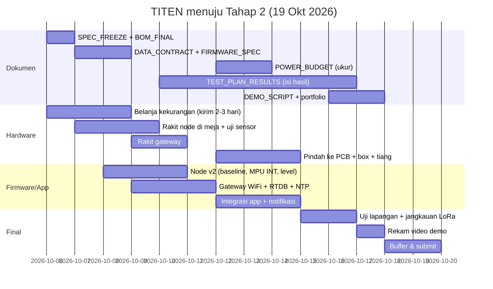

# ROADMAP DOKUMEN & ANALISIS GAP — TITEN

> **Dibuat**: Selasa, 6 Okt 2026 · **Deadline Tahap 2 (Final Works & Portfolio)**: **Senin, 19 Okt 2026, 23.59** → sisa **13 hari**
> **Tujuan**: daftar markdown yang harus dibuat dan masalah yang harus dibereskan supaya alat **benar-benar jalan end-to-end** (sensor → LoRa → gateway → internet → aplikasi) dan isi dokumen **konsisten dengan alatnya**.

---

## 1. Kondisi Sekarang (Inventaris)

| Area | Yang sudah ada | Status |
| :--- | :--- | :-: |
| Proposal | Tahap 1 (konsep), Pengajuan biaya + BOM | ✅ |
| Spesifikasi | [PRD](../Flow/PRD_Firmus_Landslide_Detection_System.md), [Diagram](../Flow/DIAGRAMS_DOCUMENTATION.md), 6 file draw.io | ⚠️ banyak yang bertentangan dengan hardware |
| Hardware | Komponen node sudah dibeli (foto), box + tiang aluminium + SMA | ⚠️ belum ada regulator daya & MCU gateway |
| Pinout | [pinout.md](../pinout.md) (lama), [PINOUT_V2.md](PINOUT_V2.md) (baru) | ✅ v2 |
| Firmware node | [node_sensor.ino](../firmware/node_sensor/node_sensor.ino) | ⚠️ inti fitur belum ada |
| Firmware gateway | [gateway_node.ino](../firmware/gateway_node/gateway_node.ino) | 🔴 belum kirim ke internet |
| Aplikasi | Flutter `titen_app/` (Firebase RTDB + mock), web `index.html` | ⚠️ riwayat masih mock |
| 3D / mekanik | [blueprint_3d.html](../blueprint_3d.html) | ⚠️ ukuran box beda dengan BOM |
| Bukti uji | — | 🔴 belum ada sama sekali |

---

## 2. Temuan Analisis (diurutkan dari yang paling berbahaya)

### 🔴 Kritis — tanpa ini, alat tidak jalan atau demo gagal

| # | Temuan | Bukti | Solusi |
| :-: | :--- | :--- | :--- |
| K1 | ~~Gateway tidak punya mikrokontroler~~ → **Sudah ada: ESP32 DevKit V1 30-pin + expansion board.** Masalahnya sekarang: `gateway_node.ino` masih memakai pin ESP32-S3 | [gateway_node.ino:20-34](../firmware/gateway_node/gateway_node.ino#L20-L34) | Ganti ke pin WROOM-32 ([PINOUT_V2 §6](PINOUT_V2.md)), dan set jumper expansion ke **3V** |
| K2 | **Tidak ada regulator dari baterai ke ESP32.** DC jack extension board butuh 6.5–9V, sedangkan baterai 1S cuma 3.0–4.2V | Foto extension board ("DC 6.5-9V") | MT3608 5V → pin 5V ([PINOUT_V2 §5](PINOUT_V2.md)) |
| K3 | **Gateway belum kirim data ke internet.** `WiFi.h` di-include tapi tidak dipakai, data cuma di-print ke Serial | [gateway_node.ino:14](../firmware/gateway_node/gateway_node.ino#L14), L155 | Tambah WiFi + Firebase RTDB (REST/library) |
| K4 | **Tilt dibaca sebagai sudut absolut, bukan Δθ dari posisi awal.** Kalau tiang terpasang miring 6°, alarm akan bunyi terus | [node_sensor.ino:163-164](../firmware/node_sensor/node_sensor.ino#L163-L164) vs PRD FR-1.4 "Δθ" | Mode kalibrasi: simpan baseline pitch/roll di NVS, lalu bandingkan dengan baseline |
| K5 | **Motion interrupt MPU-6050 tidak pernah dikonfigurasi.** Akibatnya wake-on-motion tidak akan terjadi; node hanya bangun tiap 6 jam | `setup()` tidak memanggil `setMotionInterrupt()` | `setMotionDetectionThreshold`, `setMotionDetectionDuration`, `setInterruptPinLatch(true)`, lalu clear status setelah bangun |
| K6 | **Timestamp = `millis()/1000`.** Nilainya reset setiap bangun dari deep sleep, jadi aplikasi menampilkan tahun 1970 | [node_sensor.ino:224](../firmware/node_sensor/node_sensor.ino#L224), app [firebase_node_repository.dart:48-51](../titen_app/lib/features/dashboard/data/repositories/firebase_node_repository.dart#L48-L51) | Gateway menimpa timestamp dengan waktu NTP. Field di node diganti `seq` (nomor urut paket) |
| K7 | **Alarm palsu Karhutla.** DHT22 di dalam box yang kena matahari bisa > 45 °C, flame sensor IR bereaksi ke sinar matahari, dan di firmware `flameDetected` sendirian sudah langsung memicu AWAS | [node_sensor.ino:194](../firmware/node_sensor/node_sensor.ino#L194) | DHT22 di luar box + pelindung. Flame hanya jadi bukti pendukung dan harus terbaca beberapa kali berturut-turut |
| K8 | **Frekuensi tidak konsisten.** PRD & diagram menyebut 915 MHz SX1276, padahal hardware RA-02 SX1278 **433 MHz** | PRD §1, §3, FR-3 | Semua dokumen diganti ke 433 MHz |

### 🟠 Penting — juri bisa menemukan dan menilai "klaim tidak sesuai alat"

| # | Temuan | Solusi |
| :-: | :--- | :--- |
| P1 | Klaim deep sleep **< 15 µA** dan **120 hari tanpa matahari** tidak realistis untuk DevKitC + extension board + LED modul (realitanya orde **mA**) | Ukur arus pakai multimeter, tulis angka asli di `POWER_BUDGET` |
| P2 | "**Heat interrupt DHT22** (GPIO 27)" tidak mungkin, karena DHT22 tidak punya pin interrupt | Hapus dari PRD dan diagram 01 |
| P3 | Klaim konsensus **3 node** padahal fisiknya cuma 1 node | Tulis jujur: "1 node fisik + 2 node simulasi" (simulator sudah ada di app) |
| P4 | Downlink **SIREN_OFF** dari app tidak bisa diterima node yang sedang deep sleep | Node membuka **RX window 2–3 detik** setelah TX, atau tes sirine dijalankan di buzzer posko |
| P5 | Level **SIAGA (2)** tidak pernah dihasilkan firmware. Proposal bilang alarm lokal sudah bunyi sejak Waspada, firmware baru bunyi di ≥ Siaga | Bekukan tabel level di `SPEC_FREEZE` |
| P6 | Validasi 3 syarat dari proposal (tilt, gerakan stabil, perubahan drastis kelembapan) belum diimplementasi | Sampling N kali + simpan nilai soil sebelumnya di RTC memory |
| P7 | Relay koil 3V ditulis "3.3V atau 5V" | Sudah dikoreksi di PINOUT_V2 |
| P8 | COB 3V tanpa resistor → overcurrent / brownout | R 4.7Ω 1W, ambil daya dari VBAT |
| P9 | Daftar pin terlarang tidak lengkap (GPIO 35–37 keluar di header!) | Sudah dikoreksi di PINOUT_V2 |
| P10 | Rumus baterai `raw/4095*3.3` tidak akurat di S3 | `analogReadMilliVolts()` |
| P11 | [Flutter_development.md](../Flow/Flutter_development.md) bilang Firestore, tapi app pakai **Realtime Database** | Pilih RTDB, catat di `DATA_CONTRACT` |
| P12 | AES-128, ACK, SPIFFS buffer 500 log ada di diagram 02 tapi tidak ada di firmware | Implementasi minimal ACK + buffer, atau tandai "future work" |
| P13 | Breadboard di lapangan: jumper bisa lepas karena getaran/embun | Final pakai PCB lubang + JST/terminal, lalu dikunci lem |
| P14 | Ukuran box tidak sama: BOM 200×120 IP65 vs blueprint 150×95×65 | Ukur box asli, samakan di blueprint |
| P15 | Riwayat telemetri di app masih mock | Gateway `push()` ke `history/{node}` |

### 🟡 Kecil

- Regulasi 433 MHz & TX 20 dBm: cek aturan SRD Komdigi. Untuk demo cukup sebutkan band & daya dengan jujur.
- PIN uji sirine di app masih hardcoded `1234`.
- LCD, level shifter, kapasitor, resistor, fuse, dioda belum ada di BOM.

---

## 3. Daftar Markdown yang Perlu Dibuat

Taruh semuanya di folder `docs/`. Prioritas: **P0** = wajib sebelum 19 Okt · **P1** = sangat membantu nilai · **P2** = setelah lomba.

| No | File | Prio | Tujuan singkat | Status |
| :-: | :--- | :-: | :--- | :-: |
| 00 | `docs/00_SPEC_FREEZE.md` | **P0** | Satu-satunya sumber kebenaran (freq, board, threshold, level) | ⬜ |
| 01 | `docs/PINOUT_V2.md` | **P0** | Pinout node & gateway + daya | ✅ |
| 02 | `docs/01_BOM_FINAL.md` | **P0** | BOM aktual + yang kurang + status beli | ⬜ |
| 03 | `docs/02_POWER_BUDGET.md` | **P0** | Hitung & ukur arus, estimasi umur baterai | ⬜ |
| 04 | `docs/03_ASSEMBLY_GUIDE.md` | **P0** | Langkah rakit + layout box + foto | ⬜ |
| 05 | `docs/04_FIRMWARE_SPEC.md` | **P0** | State machine node & gateway, logika keputusan | ⬜ |
| 06 | `docs/05_DATA_CONTRACT.md` | **P0** | Payload LoRa ↔ JSON gateway ↔ path Firebase ↔ app | ⬜ |
| 07 | `docs/06_TEST_PLAN_RESULTS.md` | **P0** | Kasus uji + hasil + bukti foto/video | ⬜ |
| 08 | `docs/07_DEMO_SCRIPT.md` | **P0** | Naskah video demo Tahap 2 | ⬜ |
| 09 | `docs/08_CALIBRATION.md` | P1 | Prosedur kalibrasi soil, tilt, baterai, flame | ⬜ |
| 10 | `docs/09_RISK_FMEA.md` | P1 | Risiko, dampak, mitigasi | ⬜ |
| 11 | `CHANGELOG.md` | P1 | Log perubahan versi | ⬜ |
| 12 | Revisi `Flow/PRD_...md` → v2.2 | P1 | Hapus klaim yang tidak sesuai | ⬜ |
| 13 | `docs/10_FIELD_DEPLOYMENT.md` | P2 | Cara pasang di lereng nyata | ⬜ |
| 14 | `docs/11_USER_MANUAL.md` | P2 | Panduan warga/BPBD membaca status | ⬜ |

### 3.1 Isi Wajib per Dokumen

<b>00_SPEC_FREEZE.md</b> — kerjakan PERTAMA (±1 jam rapat tim)

- [ ] Tabel keputusan: board node, board gateway, frekuensi **433 MHz**, SF/BW, jumlah node fisik
- [ ] **Tabel level final** (contoh yang disarankan):

  | Level | Longsor | Karhutla | Aksi lokal |
  | :--- | :--- | :--- | :--- |
  | 0 AMAN | Δθ < 2° dan soil < 70% | T < 40 °C dan RH > 30% | – |
  | 1 WASPADA | Δθ ≥ 2° **atau** soil ≥ 70% | T ≥ 40 °C **atau** RH ≤ 30% | LED kedip |
  | 2 SIAGA | Δθ ≥ 3.5° **dan** soil ≥ 70% | T ≥ 43 °C **dan** RH ≤ 28% | LED + buzzer putus-putus |
  | 3 AWAS | Δθ ≥ 5° **dan** soil ≥ 80% (stabil 3× sampel) | T ≥ 45 °C **dan** RH < 25%, **atau** flame 3× + T ≥ 40 °C | Sirine kontinu |
- [ ] Interval heartbeat (6 jam untuk produksi, **1–2 menit untuk demo** lewat `#define DEMO_MODE`)
- [ ] Daftar klaim yang **dihapus/direvisi** (lihat P1–P3, P12)

<b>01_BOM_FINAL.md</b>

- [ ] Kolom: Komponen · Qty · Fungsi · Harga · **Sudah punya / Belum** · Link
- [ ] Item yang **belum ada di BOM** dan wajib dibeli:

  | Item | Qty | Untuk |
  | :--- | :-: | :--- |
  | ESP32 DevKit V1 + expansion board | 1 | MCU gateway — ✅ **sudah punya**, tulis di BOM |
  | MT3608 step-up | 1–2 | Baterai → 5V |
  | LCD 16x2 + backpack I2C | 1 | Display gateway |
  | Level shifter I2C 4-ch | 1 | LCD 5V ↔ ESP32 |
  | Dioda Schottky 1N5819 | 4 | Solar & proteksi |
  | Resistor 4.7Ω 1W, 10k, 1k | beberapa | COB, pull-down, transistor |
  | Kapasitor 100 µF/16V + 100 nF | 4 | VCC LoRa |
  | Fuse 2A + holder (atau polyfuse) | 1 | Proteksi baterai |
  | PCB lubang 7×9 cm + header female + JST | 1 set | Ganti breadboard |
  | *(opsional)* P-MOSFET AO3401 | 2 | `SENSOR_EN` |

<b>02_POWER_BUDGET.md</b>

- [ ] Tabel arus per mode: **Deep sleep**, **Sampling** (±2 s), **TX LoRa** (±0.4 s di SF10), **Alarm** (relay + COB + buzzer)
- [ ] Kolom **Estimasi** vs **Terukur** (multimeter seri di OUT+)
- [ ] Rumus: `I_avg = Σ(I_mode × t_mode) / T_siklus` → `Umur = Kapasitas_efektif / I_avg`
- [ ] Neraca surya: produksi panel/hari (mis. 2 × 1W × 4 jam efektif × 0.7) vs konsumsi/hari
- [ ] Kesimpulan jujur, misalnya "±X hari tanpa matahari"

<b>03_ASSEMBLY_GUIDE.md</b>

- [ ] Urutan rakit: daya dulu (ukur!) → ESP32 → LoRa → I2C → sensor analog → relay → beban
- [ ] Layout dalam box (gambar/foto): posisi ESP32, baterai, TP4056, MPU (kaku, sumbu menghadap lereng)
- [ ] Lubang yang dibutuhkan: SMA, cable gland PG7 (soil, DHT22, buzzer, COB, solar), ventilasi
- [ ] Foto **sebelum & sesudah** tiap langkah (ini juga jadi bahan portfolio)

<b>04_FIRMWARE_SPEC.md</b>

- [ ] State machine **node**: `BOOT → (CALIBRATE?) → SAMPLE → EVALUATE → ALARM? → TX → RX_WINDOW → SLEEP`
- [ ] Sumber wake: Timer (heartbeat) · ext0 GPIO 4 (MPU INT) · bedakan pakai `esp_sleep_get_wakeup_cause()`
- [ ] Data yang disimpan di `RTC_DATA_ATTR`: `seq`, soil sebelumnya, hitungan konfirmasi
- [ ] Data di **NVS** (`Preferences`): baseline pitch/roll, kalibrasi soil dry/wet
- [ ] Konfigurasi MPU: range ±2g, threshold & duration motion, latch, lalu clear status
- [ ] State machine **gateway**: `WiFi connect → NTP → LoRa RX → CRC → push RTDB → LCD → (ACK)`
- [ ] Reconnect WiFi + antrian lokal kalau internet putus
- [ ] Daftar perubahan kode dari versi sekarang (K3–K7, P4–P6, P10)

<b>05_DATA_CONTRACT.md</b> — wajib supaya app & gateway "nyambung"

- [ ] **Payload LoRa v2 (16 byte)**: ganti `timestamp_rtc` → `uint16 seq` + `uint8 flags` (bit flame, bit wake-by-motion, bit sensor error) + 1 byte cadangan
- [ ] **RTDB path** (yang sudah dibaca app):
  - `nodes/node_01` → nilai terbaru (field: `tilt_x10`, `soil_moisture`, `air_temp_x10`, `air_humidity`, `hazard_type`, `status_level`, `battery_pct`, `rssi`, `snr`, `timestamp_rtc` = **epoch detik dari NTP gateway**)
  - `history/node_01/{pushId}` → riwayat (untuk grafik 7 hari)
  - `alerts/{pushId}` → saat `status_level ≥ 2`
  - `commands/siren_test` → ditulis app, dibaca gateway
- [ ] Contoh JSON nyata 1 paket
- [ ] Aturan keamanan RTDB (jangan dibiarkan `true/true`)
- [ ] Keputusan push notifikasi: Cloud Function (butuh plan Blaze) **atau** notifikasi lokal dari listener app

<b>06_TEST_PLAN_RESULTS.md</b> — bukti paling kuat untuk juri

| ID | Uji | Cara | Kriteria lulus | Hasil |
| :--- | :--- | :--- | :--- | :-: |
| T01 | I2C scan | Sketch scanner | 0x68 terdeteksi | ⬜ |
| T02 | Tilt | Miringkan box pakai busur derajat 0/5/10° | Error ≤ 0.5° | ⬜ |
| T03 | Soil | Udara / tanah kering / tanah basah / air | Urutan nilai benar | ⬜ |
| T04 | DHT22 | Bandingkan dengan termometer | ±1 °C | ⬜ |
| T05 | Flame | Korek api di jarak 30/50/80 cm + uji sinar matahari | Catat jarak & false positive | ⬜ |
| T06 | Baterai | Bandingkan dengan multimeter di 3.5/3.9/4.2V | ±0.05V | ⬜ |
| T07 | Wake-on-motion | Ketuk tiang saat node tidur | Bangun < 1 s | ⬜ |
| T08 | Latensi alarm lokal | Video slow-mo dari trigger sampai buzzer | < 500 ms | ⬜ |
| T09 | Jangkauan LoRa | Jalan menjauh, catat RSSI/SNR tiap 100 m | Tabel jarak vs RSSI | ⬜ |
| T10 | Packet loss | 100 paket | ≥ 95% diterima | ⬜ |
| T11 | End-to-end | Trigger → notifikasi HP | < 5 s, ada timestamp | ⬜ |
| T12 | Arus deep sleep | Multimeter seri | Catat angka | ⬜ |
| T13 | Tahan air | Siram box 5 menit | Dalam box kering | ⬜ |
| T14 | Uji 24 jam | Biarkan menyala | Heartbeat masuk semua | ⬜ |

<b>07_DEMO_SCRIPT.md</b>

- [ ] Durasi & urutan adegan: perkenalan masalah → bongkar isi box → skenario AMAN → **Longsor** (miringkan tiang + siram tanah) → **Karhutla** (hair dryer ke DHT22 + korek ke flame) → notifikasi di HP + LCD gateway → penutup
- [ ] Pakai `DEMO_MODE` supaya heartbeat pendek
- [ ] Shot list + siapa yang merekam / memegang alat

---

## 4. Jadwal 13 Hari (usulan)

**Pembagian peran (saran):** 1 orang hardware & perakitan · 1 orang firmware node + gateway · 1 orang app + dokumentasi + video.

---

## 5. Definition of Done (alat dianggap "benar jadi")

- [ ] Node bangun sendiri saat tiang digoyang, dan saat timer (DEMO_MODE)
- [ ] Alarm lokal (buzzer + COB) bunyi < 500 ms **tanpa internet**
- [ ] Paket diterima gateway, CRC valid, tampil di LCD
- [ ] Data muncul di app dengan **timestamp benar** dan riwayat grafik **bukan mock**
- [ ] Notifikasi masuk ke HP saat SIAGA/AWAS
- [ ] Alat jalan dari baterai + solar (bukan USB laptop) minimal 24 jam
- [ ] Semua angka di proposal/PRD/portfolio **sama** dengan `00_SPEC_FREEZE.md` dan hasil uji
