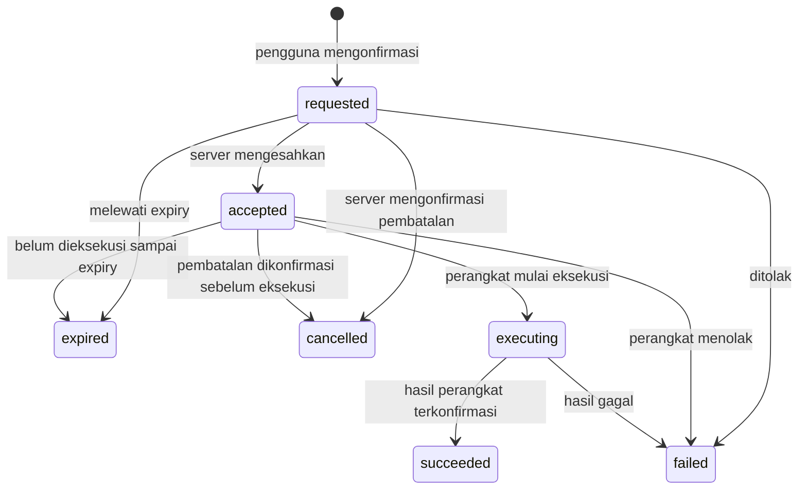

# TITEN — Design System dan Kontrak Interaksi

Versi spesifikasi: **1.0 · 7 Oktober 2026 · Asia/Jakarta**. Status: **target implementasi**, bukan pernyataan fitur sudah tersedia. Pemilik keputusan: tim produk, frontend, firmware, dan backend TITEN.

Dokumen pasangan: [Web](02_WEB_SPEC.md), [Flutter](03_APP_FLUTTER_SPEC.md), [Responsive](04_RESPONSIVE_MATRIX.md). Landasan teknis: [audit proyek](../docs/AUDIT_PINOUT_DAN_RENCANA_DEMO.md), [pinout usulan](../docs/PINOUT_V2.md), dan kode saat audit.

## 1. Keputusan produk dan batas pekerjaan

TITEN adalah alat kerja pemantauan node sensor dan gateway untuk demo lomba. Antarmuka harus membantu pengguna menjawab: perangkat mana yang bermasalah, kapan data terakhir diterima, apa buktinya, dan tindakan apa yang benar-benar dapat dilakukan.

- Web memprioritaskan observabilitas beberapa perangkat, korelasi kejadian, konfigurasi, ekspor, dan audit.
- Flutter memprioritaskan pemeriksaan cepat, detail node, tindakan lapangan, commissioning, dan penerimaan alert.
- Light/dark mengikuti pengaturan sistem pada instalasi awal; pengguna boleh memilih tema. Preferensi disimpan lokal dan tidak mengubah status perangkat.
- Keputusan font final: **Inter** untuk UI; **JetBrains Mono** untuk nilai, unit teknis, ID, waktu, dan log. Geist adalah alternatif migrasi, bukan font ketiga yang dicampur.
- Identitas visual berasal dari ketelitian tabel, ruang, tipografi, dan status; tanpa gradien dekoratif, glow, glass blur, hero marketing, atau panel kosong untuk mengisi layar.
- Radius komponen **6–10**, border 1, elevation rendah. Lingkaran hanya untuk bentuk yang fungsinya memang bulat, seperti status dot/avatar.
- **Pekerjaan rangkaian dan optimasi power ditunda sesuai arahan pengguna.** UI tetap boleh menampilkan field baterai yang tersedia; tidak mengarang estimasi umur baterai atau indikator charging tanpa data.
- BLE provisioning, MQTT/WebSocket, konfigurasi remote, dan kontrol relay adalah kontrak target yang memerlukan capability backend/firmware. Menuliskan flow tidak berarti kemampuan itu sudah aktif.

### 1.1 Bukti saat ini dan implikasinya

| Bukti repo | Kondisi saat audit | Keputusan desain |
| --- | --- | --- |
| `titen_app/lib/core/constants/app_typography.dart` | Manrope + JetBrains Mono | Migrasi UI ke Inter; data tetap mono |
| `titen_app/lib/core/theme/titen_theme.dart` | Tema light, card radius 16 | Tambah tema dark, token semantik, radius 6/8/10 |
| `firebase_node_repository.dart` | Listener RTDB, history mock, beberapa nilai default | Adapter harus menghasilkan unknown; history asli dan source label wajib |
| `dashboard_providers.dart` | Empty/loading/error dapat menjadi safe | Loading dan tidak ada data tidak boleh menjadi level AMAN |
| `settings_providers.dart` | Gateway ONLINE/915MHz/jumlah node statis | Registry dan heartbeat nyata; tampilkan belum tersedia bila tidak ada |
| `firmware/node_sensor/node_sensor.ino` | NODE_ID=1, konfigurasi radio 433 MHz | Contoh identitas memakai Node 01; frekuensi adalah konfigurasi kode, belum hasil ukur radio |
| `app.js`, `index.html`, `index.css` | Prototipe web terpisah | Stack target web perlu dibangun; komponen React belum terpasang |

Tidak ada capture telemetri fisik tervalidasi pada sesi ini. Semua contoh di bawah memakai identitas/config yang dapat ditelusuri atau keadaan data belum tersedia. Angka hasil fixture, bila dipakai di test, wajib bertanda **DEMO / fixture sintetis**, terpisah dari mode live.

## 2. Core tokens

Nama token domain menggunakan titik; CSS memakai kebab-case (`surface.panel` → `--surface-panel`), Flutter memakai properti `surfacePanel` pada ThemeExtension. Jangan menulis hex pada widget di luar definisi tema.

### 2.1 Foundation: light dan dark

| Token | Light | Dark | Fungsi |
| --- | --- | --- | --- |
| `surface.canvas` | `#FAFAFA` | `#09090B` | Latar halaman |
| `surface.panel` | `#FFFFFF` | `#18181B` | Panel, tabel, app bar |
| `surface.subtle` | `#F4F4F5` | `#27272A` | Hover, area metadata, header tabel |
| `surface.raised` | `#FFFFFF` | `#18181B` | Drawer, menu, sheet; bedakan dengan outline |
| `text.primary` | `#18181B` | `#FAFAFA` | Isi penting dan nilai |
| `text.secondary` | `#3F3F46` | `#E4E4E7` | Label utama dan deskripsi |
| `text.metadata` | `#52525B` | `#B4B4BE` | Unit, timestamp, metadata |
| `border.subtle` | `#D4D4D8` | `#3F3F46` | Divider dekoratif; bukan satu-satunya batas kontrol |
| `border.control` | `#71717A` | `#8B8B94` | Batas input, switch, tombol outline, area interaktif |
| `border.focus` | `#075985` | `#7DD3FC` | Ring fokus 2, offset 2 |
| `action.primary.bg` | `#18181B` | `#FAFAFA` | Aksi utama netral |
| `action.primary.fg` | `#FAFAFA` | `#18181B` | Label tombol primary |
| `scrim` | `#000000` @ 32% | `#000000` @ 56% | Latar overlay; tidak digunakan di belakang teks panel |

### 2.2 Semantic tokens

| Keluarga | Light `fg / bg / border` | Dark `fg / bg / border` | Makna |
| --- | --- | --- | --- |
| `semantic.normal` | `#065F46 / #ECFDF5 / #047857` | `#6EE7B7 / #052E23 / #34D399` | Bukti normal/terhubung yang valid |
| `semantic.warning` | `#78350F / #FFFBEB / #92400E` | `#FCD34D / #3A2405 / #FBBF24` | Waspada, siaga, degraded, stale |
| `semantic.critical` | `#881337 / #FFF1F2 / #BE123C` | `#FDA4AF / #3F0A1E / #FB7185` | Awas, kegagalan, offline yang terkonfirmasi |
| `semantic.syncing` | `#0C4A6E / #F0F9FF / #0369A1` | `#7DD3FC / #082F49 / #38BDF8` | Sinkronisasi, proses transport |
| `semantic.unknown` | `#3F3F46 / #F4F4F5 / #71717A` | `#D4D4D8 / #27272A / #A1A1AA` | Tidak tersedia, belum terverifikasi |

SIAGA dan WASPADA memakai keluarga amber yang sama tetapi **label, ikon dan prioritas berbeda**; jangan bergantung pada perbedaan hue kecil. Jenis bahaya ditulis Longsor/Karhutla; bukan disimpulkan dari warna. Simpan warna semantik untuk makna, jangan menjadikannya dekorasi navigasi umum.

### 2.3 Kontras yang dihitung

Perhitungan menggunakan luminansi relatif sRGB dan rasio `(Lmax+0.05)/(Lmin+0.05)`, tanpa opacity pada teks. Target produk: semua teks aktif minimal **7:1**, termasuk metadata. WCAG enhanced mensyaratkan 7:1 untuk teks biasa dan 4,5:1 untuk teks besar; target produk ini sengaja memakai 7:1 keduanya. [W3C Contrast Enhanced](https://www.w3.org/WAI/WCAG22/Understanding/contrast-enhanced.html).

| Pasangan | Light | Dark |
| --- | --- | --- |
| `text.primary / surface.panel` | 17,72:1 | 16,97:1 |
| `text.secondary / surface.panel` | 10,44:1 | 13,96:1 |
| `text.metadata / surface.panel` | 7,73:1 | 8,62:1 |
| `text.metadata / surface.subtle` | 7,03:1 | 7,24:1 |
| `semantic.normal.fg / .bg` | 7,29:1 | 9,69:1 |
| `semantic.warning.fg / .bg` | 8,75:1 | 10,15:1 |
| `semantic.critical.fg / .bg` | 8,71:1 | 8,72:1 |
| `semantic.syncing.fg / .bg` | 8,87:1 | 8,32:1 |
| `semantic.unknown.fg / .bg` | 9,50:1 | 10,08:1 |
| `border.control / surface.panel` | 4,83:1 | 5,25:1 |
| `border.focus / surface.panel` | 7,56:1 | 10,63:1 |

Seluruh pasangan text foundation pada canvas/panel/subtle/raised juga diperiksa dan mencapai 7:1; pasangan semantic border dengan background masing-masing mencapai 3:1. Batas kontrol, ikon bermakna, fokus, dan grafik perlu minimal 3:1 terhadap area bersebelahan. Divider dekoratif boleh lebih rendah bila tidak membawa informasi sendiri. [W3C Non-text Contrast](https://www.w3.org/WAI/WCAG22/Understanding/non-text-contrast.html).

Jangan menaruh semantic foreground langsung di foundation tanpa pemeriksaan baru. Jangan menurunkan opacity teks disabled; gunakan `text.metadata`, state semantik dan alasan tertulis. Nilai token lulus **bukan** sertifikasi WCAG AAA seluruh produk; fokus, reflow, screen reader, input, chart dan flow tetap harus diuji.

### 2.4 Tipografi

| Token | Font / weight | Web size / line | Flutter size / line | Penggunaan |
| --- | --- | --- | --- | --- |
| `type.pageTitle` | Inter 600 | 24 / 32 | 22 / 30 | Judul halaman, satu per route |
| `type.sectionTitle` | Inter 600 | 16 / 24 | 16 / 24 | Judul kelompok |
| `type.body` | Inter 400 | 14 / 22 | 14 / 22 | Isi dan label |
| `type.control` | Inter 500 | 14 / 20 | 14 / 20 | Tombol, input |
| `type.bodyComfortable` | Inter 400 | 16 / 24 | 16 / 24 | Instruksi lapangan dan isi mobile yang perlu keterbacaan ekstra |
| `type.controlComfortable` | Inter 500 | 16 / 24 | 16 / 24 | Form/provisioning dan kontrol touch; gunakan16 pada input mobile web untuk menghindari zoom fokus browser |
| `type.metadata` | Inter 400 | 12 / 18 desktop | 13 / 20 | Last received, unit, helper |
| `type.micro` | Inter 500 | 11 / 16 desktop opsional | Tidak untuk informasi penting | ID pendamping; tidak jadi satu-satunya label |
| `type.value` | JetBrains Mono 500 | 24 / 32 | 24 / 32 | Telemetri utama |
| `type.valueCompact` | JetBrains Mono 500 | 16 / 24 | 18 / 26 | Nilai per baris/per node |
| `type.technical` | JetBrains Mono 400 | 12 / 18 | 13 / 20 | ID, port, log, timestamp |

Line height adalah rasio saat implementasi Flutter; bukan fixed-height kontainer. Semua ukuran naik dengan text scaling. Mobile metadata minimal 13; error dan instruksi tindakan minimal 14. Label metadata boleh tracking 0,02em; paragraf dan angka 0; hindari uppercase panjang. Angka gunakan tabular digits, unit dipisahkan nonbreaking space, dan nilai rata kanan di tabel. Font self-host/bundled dengan lisensi; UI offline tidak bergantung pada unduhan font saat startup. [Inter](https://rsms.me/inter/), [JetBrains Mono](https://www.jetbrains.com/lp/mono/).

### 2.5 Geometry dan density

| Token | Nilai | Aturan |
| --- | --- | --- |
| `space.1 / .2 / .3 / .4 / .6 / .8 / .12` | 4 / 8 / 12 / 16 / 24 / 32 / 48 | Grid dasar 4, komposisi utama kelipatan 8 |
| `radius.sm / .md / .lg` | 6 / 8 / 10 | Badge/input/button / panel / sheet/drawer |
| `stroke.default / .focus` | 1 / 2 | Border presisi; bukan shadow pengganti |
| `target.min` | 48 x 48 | CSS logical px web, logical pixel/dp Flutter; ikon visual boleh 18–20 |
| `row.compact / .comfortable` | min 40 / min 56 | Baris observasi desktop / touch; kontrol di dalam tetap 48 |
| `panel.padding` | 16 desktop, 16 mobile | Dense bukan teks saling berhimpitan |
| `gap.grid` | 16 | Antar kelompok fungsional |
| `elevation.panel` | 0 | Panel dibatasi border |
| `elevation.overlay` | 0 8 24 black @ 10% light / 24% dark | Hanya menu/dialog/sheet |

Compact row 40 tidak boleh berisi tombol kontrol hardware 48; gunakan row comfortable atau perluas tinggi row. Border subpixel hanya boleh bila renderer menjaganya jelas. Fokus tidak terpotong oleh overflow/clipping.

## 3. Kontrak data dan state lintas platform

### 3.1 Tiga dimensi status, jangan digabung

| Dimensi | Enum target | Aturan tampilan |
| --- | --- | --- |
| Sumber | `live`, `demo` | DEMO persisten di shell, detail, chart, export; tidak bercampur agregasi live |
| Transport client | `online`, `reconnecting`, `offline`, `unknown` | Status koneksi ke layanan, bukan bukti node aman |
| Freshness sample | `fresh`, `stale`, `missing`, `unknown` | Dihitung dari kontrak report; simpan usia data terakhir |
| Device lifecycle | `unregistered`, `provisioning`, `active`, `planned_sleep`, `maintenance`, `revoked` | Planned sleep bukan error secara otomatis |
| Validitas per sensor | `valid`, `invalid`, `unsupported`, `unavailable` | Tampilkan setiap field secara mandiri |
| Hazard | `0 AMAN`, `1 WASPADA`, `2 SIAGA`, `3 AWAS`, `unknown` | Hanya current jika sample dan keputusan valid; jenis bahaya terpisah |

Indikator shell boleh berbunyi `LIVE`, `DEMO`, atau `OFFLINE · cache LIVE`. OFFLINE di sini state presentasi transport, bukan jenis data ketiga. Node dengan last-known AWAS tetap menampilkan **AWAS terakhir · data lama**; node tanpa data menampilkan **Belum ada data**, bukan AMAN.

Freshness memakai `R=expected_report_interval_ms` (interval laporan ke gateway/cloud) dan `J=delivery_grace_ms` dari registry. Sampling internal dan heartbeat bisa berbeda; jangan memakai sampling untuk menebak kapan paket harus muncul.

| Kondisi | State |
| --- | --- |
| `received_at` atau R/J belum valid | `unknown`; jelaskan konfigurasi/waktu belum tersedia |
| `age <= R + J` | `fresh` |
| `R + J < age <= 3R + J` | `stale` |
| `age > 3R + J` | `missing` |

`age=max(0, server_now-received_at)`. Offset server harus diketahui; jam client melenceng diberi indikator clock uncertainty. Peristiwa offline eksplisit atau kontrak jadwal valid dapat menghasilkan **offline**; missing saja disebut **tidak menerima laporan** jika jadwal belum terbukti. Planned sleep/maintenance memiliki `next_expected_at` tersendiri. Jangan menyatakan data sensor fresh hanya karena cache baru dibaca.

### 3.2 Identitas, path dan unit target

Ini kontrak **schema_version=2**, belum terpasang. Data v1 flat `nodes/node_01` dibaca melalui adapter legacy eksplisit, tidak menggunakan heuristik field yang diam-diam mengganti error dengan angka normal.

| Entitas | Path target | Isi penting |
| --- | --- | --- |
| Registry node | `registry/nodes/{node_key}` | `node_id`, `gateway_id`, label, lokasi nullable, capabilities, R/J, schema/config version |
| Registry gateway | `registry/gateways/{gateway_id}` | Identitas yang diterbitkan backend; konfigurasi dan capability |
| Gateway health | `gateway_status/{gateway_id}` | Waktu laporan, koneksi, versi, queue/error jika firmware melaporkan |
| Latest | `nodes/{node_key}/latest` | Sampel tervalidasi dan asal waktunya |
| History | `history/{node_key}/{event_id}` | Sampel immutable, cursor dan dedupe |
| Alert | `alerts/{alert_id}` | Level, hazard, node IDs, evidence, ack/resolved berbeda |
| Command | `commands/{command_id}` | Target, aksi, actor, expiry, status dan `result/device_ack` |
| Event log | `events/{event_id}` | Peristiwa operasional; source, severity, correlation ID |
| Audit log | `audit/{audit_id}` | Perubahan dan aksi operator, dihasilkan server |

`node_id` adalah integer radio 1–255; `node_key` serializer resmi: 1 → `node_01`. Jangan menghapus karakter nonangka lalu menganggap semua key invalid sebagai Node 1. `gateway_id` berasal registry; null selama belum didaftarkan, bukan ID rekaan.

| Field domain | Unit / tipe | Presentasi |
| --- | --- | --- |
| `tilt_deg` | degree, nullable; tandai absolute/baseline delta | Satu desimal setelah kalibrasi; jangan melabel delta untuk pitch absolut lama |
| `soil_moisture_pct` | indeks relatif 0–100, nullable | Label `Kelembapan tanah relatif`; bukan kadar air ilmiah |
| `air_temp_c` | °C nullable | Satu desimal sesuai precision alat |
| `air_humidity_pct` | %RH nullable | Sesuai precision sensor; bukan soil |
| `battery_pct` | estimasi % nullable | Tidak menampilkan waktu sisa/charging tanpa field pendukung |
| `rssi_dbm / snr_db` | dBm / dB nullable | Signal label harus menunjukkan link radio mana |
| `hazard_level / hazard_type` | level0–3 nullable / jenis0–2 nullable | Adapter menormalkan raw `status_level` ke `hazard_level`; jenis0 berarti normal hanya jika sampel valid |
| `observed_at` | ISO8601 UTC nullable | Waktu pengukuran jika perangkat punya waktu terpercaya |
| `received_at` | ISO8601 UTC server | Waktu penerimaan; tidak diklaim sebagai observed time |
| `sequence / session_id` | integer + ID boot/session | Dedupe bersama identitas node; bukan Unix time |
| `quality / calibration_version` | enum/map + string nullable | Bukti validitas; tampilkan uncalibrated bila belum tersedia |

Adapter mengubah raw `tilt_x10`, `air_temp_x10`, epoch detik v1, dan server epoch milidetik menjadi domain ini. `millis()/1000` firmware lama adalah uptime dan tidak boleh dikonversi ke tanggal 1970. Nilai null tidak berubah menjadi 0, 25°C, baterai100%, RSSI default, lokasi buatan, atau waktu sekarang. UI Indonesia memakai koma desimal; JSON/CSV mesin memakai decimal point, UTC dan unit eksplisit; layar menampilkan WIB beserta tanggal pada detail.

### 3.3 Contoh yang jujur terhadap data repo

Contoh view model **belum ada paket** setelah memilih identitas NODE_ID=1 dari firmware. Ini bukan capture perangkat atau record yang sudah tersimpan di RTDB.

```json
{
  "schema_version": 2,
  "node_id": 1,
  "node_key": "node_01",
  "gateway_id": null,
  "source": "live",
  "observed_at": null,
  "received_at": null,
  "freshness": "unknown",
  "hazard_level": null,
  "tilt_deg": null,
  "soil_moisture_pct": null,
  "air_temp_c": null,
  "air_humidity_pct": null,
  "battery_pct": null,
  "rssi_dbm": null,
  "snr_db": null,
  "relay_confirmed_state": "unknown"
}
```

Tampilan: `Node 01 · Belum ada data`, `Suhu — °C`, `RSSI — dBm`, `Gateway belum terdaftar`, `Terakhir diterima: belum tersedia`. Panel diagnostik dapat mencantumkan `Konfigurasi firmware: 433 MHz; belum diverifikasi pada perangkat`.

### 3.4 Command dan otorisasi



Transport ACK hanya bukti pesan diterima, **bukan** hasil eksekusi. Bila hasil tidak datang, UI menampilkan **hasil belum diketahui** setelah SLA; jangan otomatis menyatakan gagal atau mati. Server boleh menetapkan expired hanya bila eksekusi belum dimulai. Pembatalan `accepted` hanya ditawarkan bila backend/perangkat mengonfirmasi belum dieksekusi dan capability tersedia. Membatalkan request yang sedang executing tidak sama dengan mematikan relay; OFF adalah command baru dengan aturan yang sama.

ACK eksekusi menyatakan apa yang dilaporkan firmware, misalnya output relay ON. Tanpa umpan balik fisik/observasi, hasil ini tidak membuktikan kontak relay menutup atau sirine benar-benar berbunyi. Copy hasil memakai `Relay dilaporkan ON oleh perangkat`; bunyi terukur hanya boleh disebut bila ada buktinya.

Pengecekan sebelum aksi: role server, target pasti, capability, current connection/freshness, mode live, interlock perangkat, config version dan expiry. OFF dapat memiliki kebijakan fail-safe terpisah oleh firmware/server, tidak dibuat client. Jangan antrekan command offline untuk otomatis dikirim saat reconnect. Reconnect merekonsiliasi command ID yang sama, tidak mengirim ulang efek samping tanpa idempotency.

| Role target | Observasi | Kontrol | Commissioning/config | Audit/export |
| --- | --- | --- | --- | --- |
| Pengamat | Lokasi yang diizinkan | Tidak | Tidak | Sesuai hak baca |
| Operator | Lokasi yang diizinkan | Target/capability yang diizinkan | Tidak secara default | Aksi dan laporan sesuai cakupan |
| Teknisi | Perangkat yang ditugaskan | Jika diberi hak | Kalibrasi dan provisioning yang ditugaskan | Diagnostik yang ditugaskan |
| Admin | Sesuai organisasi | Hanya jika permission eksplisit | Kelola registry dan grants | Audit sesuai organisasi |

Role adalah grant backend; pilihan label profil lokal seperti BPBD bukan bukti otorisasi. Menu tersembunyi bukan kontrol akses. Bedakan **acknowledge alert**, **resolve alert**, **mute bunyi HP**, dan **OFF sirine perangkat**.

Enum role server lintas platform: `viewer` = Pengamat/Viewer, `operator` = Operator, `engineer` = Teknisi/Engineer, `admin` = Admin. Label bahasa boleh berbeda; permission dan scope memakai enum/grant yang sama.

## 4. Spesifikasi komponen bersama

Semua komponen memiliki Default, Hover/Focus, Active, Disabled, Error/Alert dan Loading bila relevan. Komponen informatif tidak diberi hover/active palsu; state N/A dicatat. Contoh memakai data yang tersedia di §3.3. Rincian layar/spesifik platform ada pada dokumen 02/03.

### DS-01 — ActionButton

- **Fungsi:** aksi utama/sekunder/destruktif; icon button adalah varian dengan accessible label.
- **Visual:** Inter14/500; min-height48; padding16 horizontal; radius6; icon18 dengan gap8. Primary memakai action tokens, secondary panel/control border, destructive semantic.critical bg/fg/border; tanpa glow.
- **State:** default label kata kerja; hover/focus ring tanpa mengubah lebar; active inset border tanpa scale; disabled tetap terbaca dengan alasan; error inline di konteks aksi; loading spinner16 menggantikan ikon, lebar tetap, cegah double-submit.
- **Contoh:** `Hubungkan gateway` tersedia pada setup; `Uji sirine` disabled dengan alasan `Gateway belum terdaftar`.

### DS-02 — StatusBadge

- **Fungsi:** satu dimensi status per badge; jangan menyatukan bahaya dan koneksi.
- **Visual:** font12/500 desktop,13 mobile; radius6; padding4/8; icon12 + label; semantic fg/bg/border1; glyph dan teks membawa makna.
- **State:** default unknown bila belum ada bukti; hover/focus hanya bila membuka penjelasan; active selected filter memiliki check; disabled bukan status perangkat; error critical + alasan; loading `Memeriksa koneksi` dengan syncing, tidak Online sementara.
- **Contoh:** `Node 01 · Belum ada data`, badge terpisah `LIVE`; tidak menampilkan AMAN dari null.

### DS-03 — TelemetryPanel

- **Fungsi:** tampilkan nilai, unit, waktu, kualitas dan konteks sensor.
- **Visual:** panel border.subtle1/radius8/padding16; label14; nilai mono24; unit metadata13; footer timestamp. Kartu informatif tidak mengambang/berhover. Link detail berupa tombol target48 yang jelas.
- **State:** default nilai valid; hover/focus pada link; active metric yang dipilih outline.control; disabled unsupported menyebut `Sensor tidak tersedia`; error invalid menampilkan dash + alasan dan last-known terpisah; loading skeleton sebelum data pertama; stale menjaga angka terakhir + usia/label amber.
- **Contoh:** `Suhu udara — °C · Belum menerima sampel`; data baterai null tetap dash, bukan100%.

### DS-04 — RelayControl

- **Fungsi:** meminta perubahan perangkat sambil menampilkan **confirmed state** terpisah dari **requested state**.
- **Visual:** baris panel radius8; label `Sirine Node 01`; state text13; toggle track44x24 dalam hit area48; border.control; unknown memakai unknown, confirmed ON/OFF netral/semantic sesuai konteks alarm.
- **State:** default mengikuti device_ack terbaru; hover/focus menjelaskan target; active membuka confirmation sheet sebelum request; disabled role/capability/offline dengan alasan; error mempertahankan state perangkat terakhir dan menampilkan hasil command; loading `Menunggu hasil perangkat` tidak menggeser thumb menjadi ON optimistis.
- **Contoh:** `Keadaan sirine: belum diketahui` dan `Uji sirine` disabled karena belum ada gateway. Sukses hanya setelah device_ack; tidak dibuat dari penulisan database.

### DS-05 — RealtimeChart

- **Fungsi:** tren satu metrik per plot dan range waktu yang dapat diaudit.
- **Visual:** plot min160 high + header/legend/footer; mono12 ticks, data13 mobile; stroke2 dengan marker terpilih; seri sky/emerald dari semantic border, line style berbeda; satuan eksplisit. Teks memakai foundation, bukan warna seri muda.
- **State:** default hanya titik tersimpan; hover/focus cursor bertimestamp dan tabel alternatif; active range/metric terpilih; disabled history unsupported menyebut sebab; error retry tanpa menghapus last-known range; loading skeleton, bukan garis contoh; null/gap memutus garis, tidak interpolasi sebagai fakta.
- **Contoh:** `Riwayat Node 01 belum tersedia`; tidak ada sparkline sebelum paket asli. Tabel data dan ekspor menyertakan kualitas/source, observed dan received time.

### DS-06 — Field dan Select

- **Fungsi:** filter/config yang terbatas domain; label persisten, helper dan validasi.
- **Visual:** panel input min48; border.control1/radius6/padding12; label14/500; value14 atau mono13 untuk teknis; unit di suffix; placeholder bukan label.
- **State:** default nilai backend; hover/focus ring; active edited menampilkan dirty marker; disabled capability/role dengan alasan; error field-level + summary; loading existing value tetap terlihat read-only dengan status fetching.
- **Contoh:** `Gateway: belum dipilih`; `Frekuensi konfigurasi firmware: 433 MHz` read-only sampai konfigurasi remote didukung. Jangan memberi opsi915MHz seolah radio tersedia.

### DS-07 — DeviceRow / DeviceLink

- **Fungsi:** identitas, status, last received, RSSI dan akses detail.
- **Visual:** row56 touch atau40 informatif desktop; Inter14 nama, mono13 ID/nilai, metadata13 mobile; border.subtle bawah; fokus pada primary link yang punya target48.
- **State:** default menampilkan semua dimensi status; hover surface.subtle hanya area clickable; active selected border/control; disabled revoked tetap dapat dibaca bila role mengizinkan; error unknown field per kolom; loading skeleton row dengan struktur stabil.
- **Contoh:** `Node 01 | Gateway belum terdaftar | Belum ada data | RSSI — dBm`.

### DS-08 — EventLogRow

- **Fungsi:** diagnostik dan korelasi kejadian; bukan daftar angka sensor yang setiap tick memicu toast.
- **Visual:** mono12/18 desktop,13/20 mobile; timestamp + severity + source + pesan; INFO netral, WARN amber, ERROR rose, DEBUG muted; border subtle; detail terbungkus, bukan ellipsis permanen.
- **State:** default append dengan batas buffer; hover/focus detail terpilih; active pause live tail; disabled source unsupported terlihat; error disconnect mempertahankan buffer berlabel cache; loading `Mengambil log`; announcement screen reader dibatasi.
- **Contoh:** empty `Log gateway belum tersedia`; event `node_01` hanya bila adapter benar-benar menerbitkannya. Jangan membuat baris MQTT palsu.

### DS-09 — AlertBanner

- **Fungsi:** kejadian yang butuh perhatian, dapat diikuti ke evidence dan prosedur.
- **Visual:** border semantic1, stripe kiri3, radius8; icon20; judul14/600 + body14; tindakan48; level/hazard/node/waktu tertulis; tidak blink.
- **State:** default mengikuti alert backend; hover/focus pada action; active membuka detail; disabled action sesuai permission; error detail missing menyebut keterbatasan, tidak dismiss diam-diam; loading belum mengklaim level; acknowledged tetap terlihat sampai resolved sesuai kebijakan.
- **Contoh:** saat stream belum siap `Status bahaya belum dapat ditentukan`; bukan banner hijau default. Mute bunyi aplikasi tidak menyelesaikan alert.

### DS-10 — Drawer / BottomSheet / Confirmation

- **Fungsi:** tugas kontekstual singkat, detail, parameter, dan konfirmasi hardware.
- **Visual:** raised/radius10, border1; desktop drawer420–480; mobile sheet sesuai §04, padding16, judul16/600; footer actions48 dan safe area. Scrim tanpa blur.
- **State:** default focus heading/field pertama; hover/focus actions; active form dirty; disabled submit jika invalid; error tetap di sheet dengan retry yang aman; loading blok submit, bukan tombol tutup pengamatan. Dismiss meminta discard hanya untuk draft perubahan, tidak membatalkan command yang sudah diterima server.
- **Contoh:** konfirmasi `Uji sirine pada Node 01` menampilkan target, durasi yang didukung registry, dan hasil koneksi; data tidak tersedia membuat submit disabled.

### DS-11 — Loading / Empty / ErrorRecovery

- **Fungsi:** membedakan belum pernah ada data, filter kosong, error dan cache.
- **Visual:** skeleton surface.subtle tanpa data palsu; empty icon24 + title14 + body14 + satu CTA; radius8; error memakai semantic border dengan pesan dapat ditindaklanjuti.
- **State:** default empty faktual; hover/focus CTA; active retry; disabled retry saat request berjalan; error code/correlation ID di detail; loading skeleton hanya awal, subsequent fetch memakai inline progress di atas cache.
- **Contoh:** `Node belum melapor` → `Lihat panduan koneksi`; `Tidak ada hasil filter` → `Reset filter`; permission denied → `Minta akses`, bukan retry tanpa akhir.

### DS-12 — FilterToolbar / DateRange

- **Fungsi:** menyempitkan node, gateway, hazard, freshness, source dan rentang waktu.
- **Visual:** controls48/radius6; labels14; chip aktif13 dengan tombol clear48; max dua baris lalu panel filter; summary rentang beserta WIB.
- **State:** default range eksplisit tanpa mengarang data; hover/focus tiap control; active jumlah filter aktif; disabled opsi tanpa capability; error end<start inline; loading hasil tidak mengubah filter atau scroll.
- **Contoh:** `Node: 01 · Sumber: LIVE · Riwayat belum tersedia`; filter clear tidak menghapus data.

### DS-13 — NavigationItem

- **Fungsi:** rute kerja dan orientasi, bukan shortcut tindakan hardware.
- **Visual:** Inter14/500, icon20, hit48, radius6, active surface.subtle + border/marker, bukan warna semua status; badge count hanya dari data nyata.
- **State:** default route tersedia; hover/focus label/tooltip rail; active aria-current/Semantics selected; disabled capability menjelaskan dependensi; error route menampilkan recovery; loading shell tetap dapat dinavigasi bila aman.
- **Contoh:** `Perangkat` → Node01; badge Alert tidak menampilkan0 jika stream belum tersedia—gunakan `—` atau tanpa count.

### DS-14 — Toast / OutcomeNotice

- **Fungsi:** hasil aksi lokal atau konfirmasi server yang tidak memerlukan blocking dialog.
- **Visual:** raised/radius8/border1, text14, icon16, close48; maksimum satu notice utama; tidak menutupi kontrol bawah. Outcome persisten berada di detail command, toast pelengkap.
- **State:** default pesan berbasis fakta; hover/focus menunda auto-dismiss notice informatif; active link detail; disabled N/A; error actionable tidak hilang sebelum dapat dibaca; loading bukan toast sukses.
- **Contoh:** `Filter direset` boleh langsung; `Permintaan sirine diterima server` berbeda dari `Relay dilaporkan ON oleh perangkat`.

### DS-15 — PreferenceSwitch

- **Fungsi:** preferensi lokal seperti tema/haptics; berbeda dari RelayControl.
- **Visual:** switch44x24 dalam target48, label14 + helper13, radius6 pada row; border.control dan check/label ON/OFF.
- **State:** default nilai tersimpan; hover/focus ring; active lokal boleh langsung jika penyimpanan sukses; disabled kebijakan/izin; error rollback local value dan alasan; loading untuk preferensi server yang masih disimpan.
- **Contoh:** `Getaran interaksi: mati` adalah preferensi aplikasi, tidak menyatakan relay mati. Switch notifikasi membuka pengaturan OS jika izin ditolak.

## 5. Iconography, motion, sound dan haptics

Lucide outline menjadi referensi visual icon; web menggunakan package Lucide React pada stack target. Flutter boleh memakai Material equivalents sementara sebelum adapter flutter_lucide disahkan. Satu layar tidak mencampur gaya filled dan outline untuk fungsi yang sama. Icon18/20/24, stroke1.75–2, alignment optis, label teks untuk fungsi kritis. Decorative icon disembunyikan dari semantics; icon button diberi nama aksi+target. [Lucide Accessibility](https://lucide.dev/how-to/accessibility).

| Interaksi | Motion target | Haptics/sound | Syarat |
| --- | --- | --- | --- |
| Hover/focus | 100–120ms color/border | Tidak | Tidak menggeser layout |
| Menu/sheet | 160–200ms translate<=8 + opacity | Tidak wajib | Reduced motion menjadi perubahan instan/fade<=80ms |
| Ganti tab/range | 120ms | Selection feedback native opsional | Tidak mereset chart dengan animasi garis palsu |
| Data sensor baru | Nilai berganti tanpa count-up | Tidak | Tidak haptic setiap paket |
| Konfirmasi request relay | Tombol progress | Selection feedback opsional | Bukan feedback bahwa alat sukses |
| `device_ack` sukses/gagal | Outcome state | Satu feedback sesuai preferensi | Dedupe command ID; respect OS, silent dan aksesibilitas |
| Alert baru | Banner stabil | Kanal notifikasi OS | Dedupe alert ID/escalation; tidak memaksa bypass Do Not Disturb |

Jangan mengklaim getaran berasal dari tombol fisik di lapangan tanpa event hardware. Bila firmware menerbitkan physical_button event, tampilkan asalnya dan jangan memicu ulang command otomatis. Status critical tidak berkedip terus-menerus; suara/alarm device tidak dikendalikan oleh mute notifikasi HP.

## 6. Referensi desain: apa yang diambil

Referensi adalah arah organisasi informasi, bukan menyalin halaman marketing atau menyatakan fitur platform lain tersedia di TITEN.

| Referensi resmi | Prinsip yang diterapkan pada TITEN |
| --- | --- |
| [Linear](https://linear.app/) | Navigasi konsisten, hierarchy teks, konteks detail ringkas |
| [Supabase](https://supabase.com/) | Area kerja data, tabel dan detail terstruktur; Studio perlu ditinjau pada akses produk saat implementasi |
| [Datadog](https://www.datadoghq.com/) | Korelasi metrik/event dan konteks waktu, sebagai arah observabilitas |
| [Grafana](https://grafana.com/) | Panel yang bisa ditelusuri ke data dan rentang waktu |
| [Apple Home](https://www.apple.com/home-app/) | Status perangkat dan tindakan yang mudah ditemukan |
| [Bambu Lab](https://bambulab.com/) | Referensi awal mobile hardware; halaman belum dapat dibaca saat audit, tidak menjadi dasar klaim fitur |
| [ThingsBoard Mobile](https://thingsboard.io/docs/mobile/) | Hubungan perangkat, dashboard dan event pada mobile |

Pemetaan library target dan keputusan native dijelaskan pada dokumen02/03. Context7 skill telah dibaca, tetapi tool Context7 tidak tersedia pada sesi ini; verifikasi dilakukan melalui dokumentasi primer. Tidak ada dependency yang dipasang oleh pekerjaan spesifikasi ini.

## 7. Handoff, migration dan kriteria penerimaan

### 7.1 Urutan implementasi

1. Implementasikan token/theme/type/icon adapters; pilih font bundled dan daftar lisensi.
2. Implementasikan domain DTO nullable, v1 adapter dan reducer status/command; gunakan kontrak backend yang disahkan tim.
3. Bangun komponen DS-01 sampai DS-15 dengan story/state gallery live/demo terpisah.
4. Terapkan layar inti overview/device/alerts, lalu history/log/export; provisioning/config hanya saat capability tersedia.
5. Ganti mock history, state safe default, koordinat dan health statis; role berasal server.
6. Jalankan checklist aksesibilitas/responsive dan skenario perangkat pada dokumen02/03/04.

Mapping file Flutter: `app_colors.dart` → tokens; `app_typography.dart` → Inter+Mono; `titen_theme.dart` → light/dark + extensions; `bento_card.dart` → TelemetryPanel; `status_banner.dart` → status berdimensi; `pin_modal.dart` → konfirmasi sesuai grants, bukan PIN hardcoded; `responsive_shell.dart` + `app_router.dart` → breakpoint dan navigation target. Backend dan firmware adalah dependensi eksplisit, bukan ditutupi UI.

### 7.2 Acceptance checklist

- [ ] Keempat dokumen memakai nama token, enum command, node identity, timezone dan breakpoint yang sama.
- [ ] Semua komponen memiliki state gallery: awal kosong, loading, valid, stale, offline, error, disabled, role denied, dan DEMO.
- [ ] Semua pasangan warna teks/ikon/control di screenshot akhir diperiksa; opacity, hover, selected dan theme tidak merusak kontras.
- [ ] Keyboard/screen reader dapat memahami node, level, usia data, target aksi dan hasil; warna bukan satu-satunya indikator.
- [ ] Text scaling200%, web reflow/zoom, SafeArea dan target48 diuji sesuai dokumen04.
- [ ] Null/invalid timestamp tidak menghasilkan angka normal, AMAN, lokasi default, atau "baru saja".
- [ ] Latest/history/export memakai identitas sampel dan satuan yang sama; DEMO tidak tercampur data live.
- [ ] Toggle/request tidak menyatakan berhasil sebelum hasil perangkat; hasil hilang, retry, cancel dan reconnect tidak menggandakan tindakan.
- [ ] Alert acknowledged, resolved, mute app, dan OFF perangkat dapat dibedakan pada UI dan audit.
- [ ] Typeface, spacing, corner, density dan keadaan error konsisten pada web/native; tidak ada meter fiktif atau panel dekoratif.

### 7.3 Definition of ready untuk layar

Layar boleh masuk pengerjaan bila mempunyai route, permission/capability, field dan unit, sumber data, aturan empty/error/stale, component IDs, layout di tiga kelas viewport, serta acceptance cases. Ketiadaan endpoint/firmware diberi blocker terukur dan tampilan disabled yang jujur. Spesifikasi ini siap menjadi kontrak implementasi; keputusan hardware/power serta validasi operasi lapangan tetap di luar pekerjaan UI ini.
